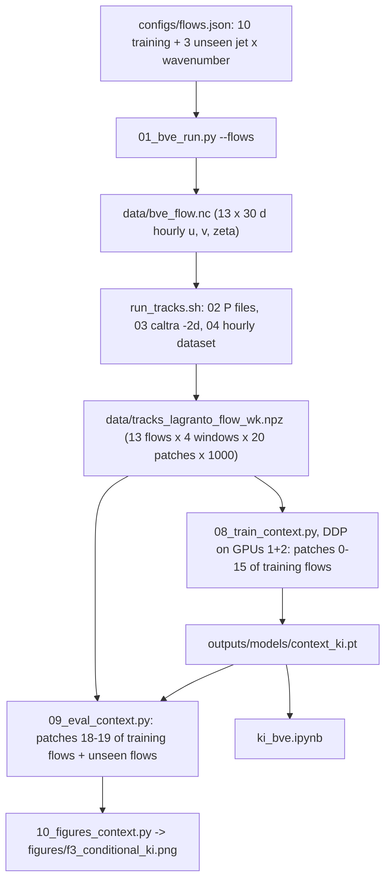
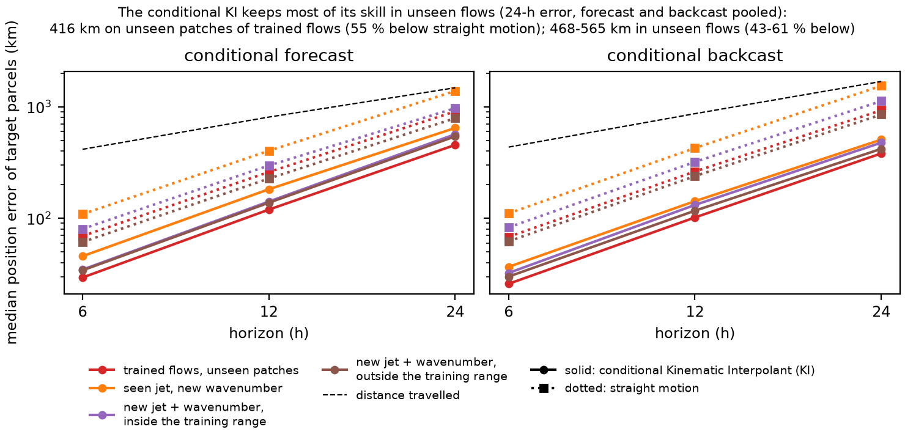

# 01_bve — conditional forecasts and backcasts of parcel tracks in stirred barotropic jets

Two-dimensional test of trajectory inference with a conditional Kinematic Interpolant (KI). Air parcels are
released in compact patches (1000 parcels in a 300-km disk, as in the ocean data of the KI paper) into 13
statistically steady, stochastically stirred jets of the barotropic vorticity equation on the sphere; LAGRANTO
computes their tracks. A context transformer predicts the acceleration and velocity score of the paper,
a(t, x, v | context), where the context is the observed tracks of the other parcels of the patch. Two tasks:

- **conditional forecast**: the patch was observed for the 48 h before the anchor time; every parcel is unobserved
  after it; the target parcels (not in the context) are integrated forward 6–24 h from their anchor state;
- **conditional backcast**: the patch was observed for the 48 h after the anchor time; the targets are integrated
  backward 6–24 h.

The model is trained on 8e5 tracks from 10 flows (5 jets × stirred zonal wavenumbers 4 and 8) and tested on
unseen patches of those flows and on 3 flows it never saw.

## Pipeline

| Step | Script | Output |
| --- | --- | --- |
| 1 | `scripts/01_bve_run.py --flows configs/flows.json` — 13 BVE runs in one GPU batch (torch-harmonics, T85, dt 600 s): relaxation to a jet, AR(1) vorticity stirring at one zonal wavenumber centred on the jet latitude, 60-day spin-up | `data/bve_<flow>.nc`: hourly u, v, ζ on a 1° grid, 30 days |
| 2–4 | `scripts/run_tracks.sh` — per flow and window (start days 2, 9, 16, 23): `02_lagranto_input.py` (P files), `03_tracks.py` (20 patches × 1000 parcels, centres 30–65°N ≥ 1500 km apart, `caltra -2d`, 1-min step), `04_dataset.py --every-h 1` (polar-stereographic positions, spline velocity and acceleration) | `data/tracks_lagranto_<flow>_w<k>.npz` (157 hourly times × 20 000 parcels) |
| 5 | `scripts/08_train_context.py` (`scripts/run_context.sh 1,2`: `torchrun` DDP) — training patches 0–15 of the training flows, validation patches 16–17 | `outputs/models/context_ki.pt`, live panels in `outputs/logs/` |
| 6 | `scripts/09_eval_context.py` — unseen patches 18–19 of the training flows and all patches of the unseen flows; anchors 48, 72, 96 h after release; 128 target parcels not in the context | `outputs/eval/context_ki.csv.gz` |
| 7 | `scripts/10_figures_context.py` | `figures/f3_conditional_ki.png` |
| — | `ki_bve.ipynb` (written by `scripts/build_ki_bve_notebook.py`) — the ocean notebook's layout for the conditional KI: flows, model code, minibatches, training (or loading the DDP model), evaluation, examples | — |

## Flows

| flow | split | relaxation jet | stirred m | realized jet (30-day mean) |
| --- | --- | --- | --- | --- |
| `j1_m4` | train | 25 m/s, 35°N, 8° | 4 | 39 m/s at 37°N |
| `j1_m8` | train | 25 m/s, 35°N, 8° | 8 | 37 m/s at 34°N |
| `j2_m4` | train | 30 m/s, 45°N, 10° | 4 | 48 m/s at 50°N |
| `j2_m8` | train | 30 m/s, 45°N, 10° | 8 | 40 m/s at 45°N |
| `j3_m4` | train | 35 m/s, 55°N, 8° | 4 | 46 m/s at 58°N |
| `j3_m8` | train | 35 m/s, 55°N, 8° | 8 | 46 m/s at 53°N |
| `j4_m4` | train | 40 m/s, 40°N, 6° | 4 | 40 m/s at 48°N |
| `j4_m8` | train | 40 m/s, 40°N, 6° | 8 | 45 m/s at 41°N |
| `j5_m4` | train | 20 m/s, 50°N, 14° | 4 | 42 m/s at 57°N |
| `j5_m8` | train | 20 m/s, 50°N, 14° | 8 | 41 m/s at 49°N |
| `o1_j2_m6` | unseen: seen jet, new wavenumber | 30 m/s, 45°N, 10° | 6 | 44 m/s at 48°N |
| `o2_jnew_m6` | unseen: new jet and wavenumber, inside the training range | 30 m/s, 50°N, 10° | 6 | 39 m/s at 52°N |
| `o3_jout_m10` | unseen: new jet and wavenumber, outside the training range | 45 m/s, 60°N, 6° | 10 | 35 m/s at 58°N |

The eddies move the realized jets away from their relaxation targets; `o3`'s jet ends at 58°N, inside the
latitude range of the training jets, so it is "outside" through its wavenumber (10) and its weaker jet.

## The model

`scripts/ctx_model.py`, `scripts/ctx_data.py`. Context tokens: 128 parcels of the patch every 3 h over the 48 h on
the observed side, each token (time relative to the anchor, position relative to the patch centroid, sin latitude,
velocity), with Fourier features. A Perceiver encoder (64 latents, 4 self-attention layers, width 256) compresses
them; the query state (t, x, v) of a target parcel reads the latents through 2 cross-attention layers and returns
the acceleration and the scaled velocity score. Training targets follow the paper: query states lie on and around
the true tracks within 24 h on the unobserved side (rotating Gaussian noise, 5 km, time scale 6 h) and the target
acceleration includes the noise's restoring term. AdamW, warm-up and cosine decay, EMA 0.999, 40 000 steps × 32
samples per GPU on 2 GPUs (DDP; the same script runs on more GPUs or nodes through `torchrun`).

## Results

Medians over 128 target parcels per patch, anchors 48/72/96 h, 80 patches per case
(`outputs/eval/context_ki.csv.gz`); `straight` = straight motion at the anchor velocity.

| case | forecast 6 / 12 / 24 h (km) | straight | backcast 6 / 12 / 24 h (km) | straight |
| --- | --- | --- | --- | --- |
| training flows, unseen patches | 29 / 120 / 454 | 69 / 259 / 907 | 26 / 102 / 381 | 68 / 262 / 929 |
| seen jet, new wavenumber | 46 / 182 / 645 | 109 / 402 / 1383 | 37 / 142 / 507 | 111 / 426 / 1537 |
| new jet and wavenumber, inside the range | 35 / 141 / 566 | 80 / 297 / 969 | 32 / 132 / 476 | 83 / 320 / 1122 |
| new jet and wavenumber, outside the range | 34 / 138 / 542 | 61 / 227 / 789 | 30 / 117 / 419 | 62 / 238 / 850 |

- The model keeps most of its skill in flows it never saw: errors there are 10–60 % larger than on unseen patches
  of the training flows and 30–67 % below straight motion at every horizon.
- Backcasts are slightly better than forecasts in every case.
- At 24 h the errors are 23–36 % of the distance travelled (1480–2080 km); at 6 h, 6–8 %.

## Why the model reads the other parcels

A first version fitted one unconditional KI, a(t, x, v), per patch (the ocean-paper set-up; one stirred flow,
8 patches, window 24–120 h after release). It filled gaps in the training window almost perfectly (24-h gaps: 1.5 km)
because the other parcels had already shown it the field at those times, but its 24-h forecasts and backcasts were
only slightly better than straight motion (585 and 802 km against 683 and 1396 km), and on another region of the
same flow, a new stirring, or a new jet, its gap filling was worse than straight motion (173–219 km against
108–153 km): its inputs carry no information about which flow it is in.

Design step: `scripts/design/tune_stirring.py` chose the stirring amplitude (4e-10 s⁻²) so that parcels move at about
23 m/s and turn within about 20 h in a 30 m/s jet (`outputs/design/tune_stirring*.json`).

## Tests

`micromamba run -n kinematic_interpolants python -m pytest -q tests/`
