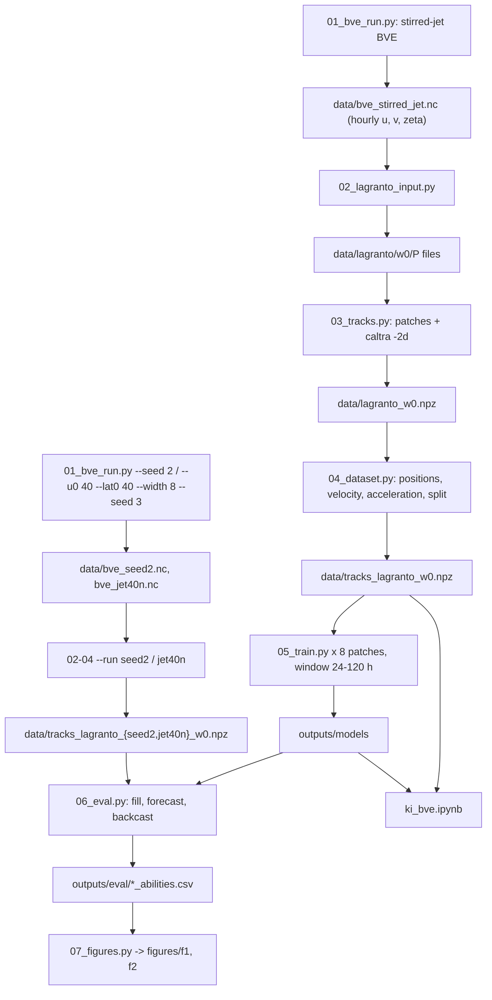
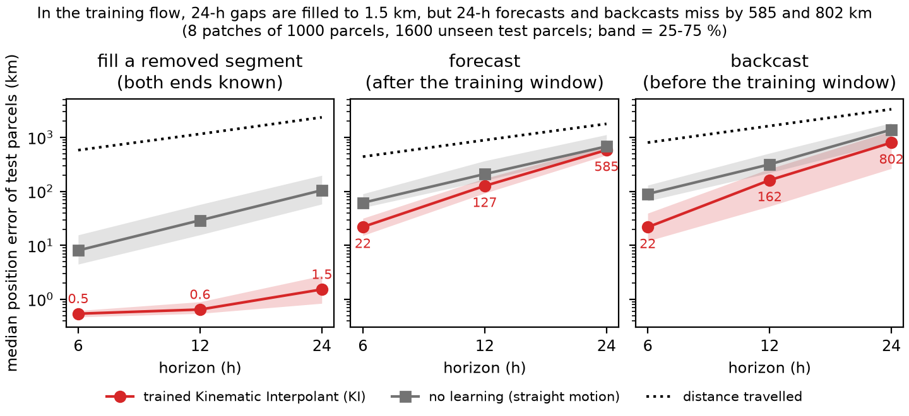
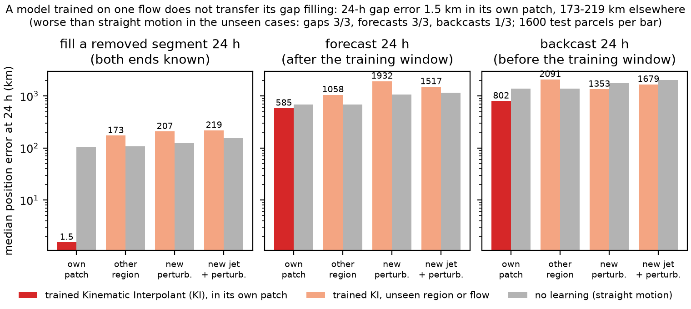

# 01_bve — filling and forecasting parcel tracks in a stirred barotropic jet

Two-dimensional test of trajectory inference with Kinematic Interpolants (KI). Air parcels are released in compact
patches, as in the ocean data of the KI paper, into a statistically steady, stochastically stirred midlatitude jet
of the barotropic vorticity equation on the sphere. LAGRANTO computes their tracks. For each patch, one KI model is
trained on 70 % of the parcels over the window 24–120 h after release; the 20 % test parcels are never seen in
training. Three abilities are scored on the test parcels: filling a randomly removed segment of 6–48 h inside the
window, forecasting 6–24 h after it, and backcasting 6–24 h before it. The same models are then applied to parcels
released at the same places and time in flows they never saw: another region of the training flow, a new random
stirring of the same jet, and a different jet with a new stirring.

## Pipeline

| Step | Script | Output |
| --- | --- | --- |
| 1 | `scripts/01_bve_run.py` — BVE (torch-harmonics, T85, dt 600 s) with relaxation to a jet and red-noise vorticity stirring (l = 8–14, 45 ± 12°N); 60-day spin-up. Training flow: 30 m/s jet at 45°N, 10° wide, seed 1; unseen flows: same jet with seed 2 (`--seed 2`), and a 40 m/s jet at 40°N, 8° wide, seed 3 | `data/bve_stirred_jet.nc` (30 days), `data/bve_seed2.nc`, `data/bve_jet40n.nc` (9 days): hourly u, v, ζ on a 1° grid |
| 2 | `scripts/02_lagranto_input.py [--run R]` — 6.5 days of the hourly wind from day 2 as LAGRANTO P files | `data/lagranto/w0[_R]/P*` |
| 3 | `scripts/03_tracks.py [--run R]` — 8 patches × 1000 parcels in 300-km disks (centres uniform in area, 35–60°N, ≥ 2000 km apart; the same in every run), `caltra -2d`, 1-min step, 10-min output, 156 h | `data/lagranto[_R]_w0.npz` |
| 4 | `scripts/04_dataset.py [--run R]` — polar-stereographic positions, spline velocity and acceleration, hours after release, split by parcel 70/10/20 within each patch | `data/tracks_lagranto[_R]_w0.npz` |
| 5 | `scripts/05_train.py` (all patches: `scripts/run_training.sh`, patches spread over GPUs) — acceleration and score networks per patch on 24–120 h after release; DDP-ready (`torchrun`) | `outputs/models/*.pt`, live panels in `outputs/logs/` |
| 6 | `scripts/06_eval.py` — fill, forecast, backcast on the test parcels, in the training flow and in the unseen flows | `outputs/eval/tracks_lagranto_w0_abilities.csv` |
| 7 | `scripts/07_figures.py` | `figures/f1_abilities.png`, `figures/f2_unseen_flows.png` |
| — | `ki_bve.ipynb` (written by `scripts/build_ki_bve_notebook.py`) — the ocean notebook's layout on these data, self-contained | — |

Design step: `scripts/design/tune_stirring.py` chose the jet and stirring so that parcels move at about 23 m/s and
turn within about 20 h (the LAGRANTO patches: median speed 27.5 m/s, turning time 21.6 h) (`outputs/design/tune_stirring*.json`); `scripts/design/heun_tracks.py` advects the same patches
with an independent integrator for a cross-check of the LAGRANTO tracks.

## The model

`scripts/ki_tracks.py`. The paper's two ReLU MLPs `Field(t, x, v)` (acceleration and velocity score) with
polynomial and Fourier features of time; here width 512, depth 4, Fourier periods down to 6 h (the ocean runs used
256 × 2 and periods down to a quarter window). Each training sample is a training parcel at a random time, displaced
by the paper's rotating Gaussian noise (time scale 6 h); its target is the parcel's true acceleration plus the
noise's restoring term. A gap is filled by integrating forward from its start and backward from its end and
blending the two; a forecast integrates forward from the last known state.

## Results

Window 0 (release on day 2 of the record), 8 patches, 1600 test parcels; medians of the great-circle error (km), for
`fill` averaged along the removed segment, for `forecast` and `backcast` at the end point. `no learning` = straight
motion at the known velocities (from both ends for `fill`). Source: `outputs/eval/tracks_lagranto_w0_abilities.csv`.

| ability | 6 h | 12 h | 24 h | 48 h | distance travelled at 24 h |
| --- | --- | --- | --- | --- | --- |
| fill (trained / no learning) | 0.5 / 8.1 | 0.6 / 29 | 1.5 / 105 | 4.5 / 371 | 2361 |
| forecast | 22 / 62 | 127 / 210 | 585 / 683 | — | 1787 |
| backcast | 22 / 90 | 162 / 317 | 802 / 1396 | — | 3336 |

- Filling works because the other parcels of the patch have already shown the model the acceleration field at the
  gap's times and places. Forecasting and backcasting leave the training window, where the time-dependent field
  a(t, x, v) has never been seen; skill is useful for about 6–12 h and nearly gone by 24 h (vorticity e-folding time
  of the flow: 17–21 h).
- Backcasting behaves like forecasting (same model, integrated backward from the window start).

| 24-h error, trained / no learning | fill | forecast | backcast |
| --- | --- | --- | --- |
| own patch | 1.5 / 105 | 585 / 683 | 802 / 1396 |
| same flow, other region | 173 / 108 | 1058 / 683 | 2091 / 1396 |
| new perturbation (seed 2) | 207 / 125 | 1932 / 1074 | 1353 / 1767 |
| new jet and perturbation | 219 / 153 | 1517 / 1158 | 1679 / 2023 |

- A per-patch model does not transfer: in another region or another flow its gap filling is worse than straight
  motion. Its inputs (t, x, v) carry no information about the flow, so the field it learned belongs to one region of
  one realization.
- Over the evaluation window the "new jet" run (relaxation target 40 m/s at 40°N, 8° wide) settled to a midlatitude
  jet of 33.8 m/s at 47°N, close to the training flow (33.9 m/s at 47°N); it differs mainly in its subtropical
  easterlies (−17 m/s) and its eddies. A test with a displaced jet needs a stronger contrast.
- Training was stopped at 20 000 steps while the validation gap error was still falling (live panels in
  `outputs/logs/`); the training loss itself sits on the floor set by the rotating-noise targets.

## Tests

`micromamba run -n kinematic_interpolants python -m pytest -q tests/`
