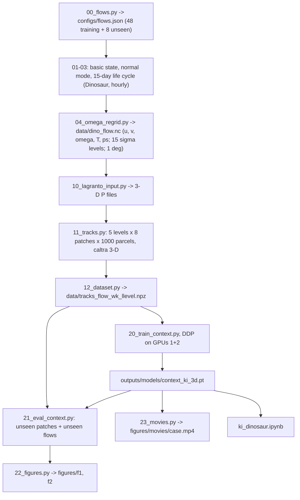
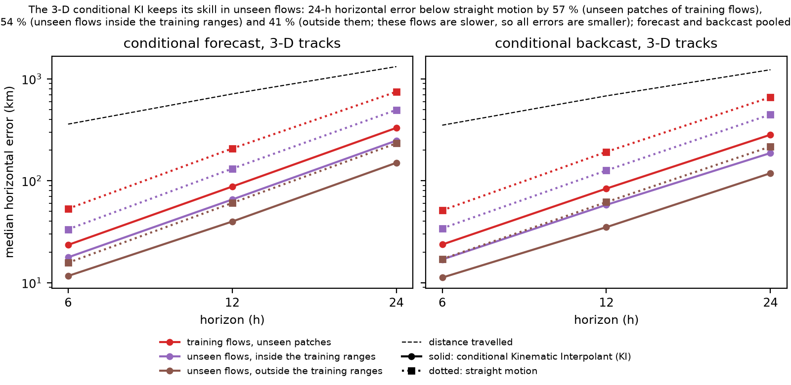
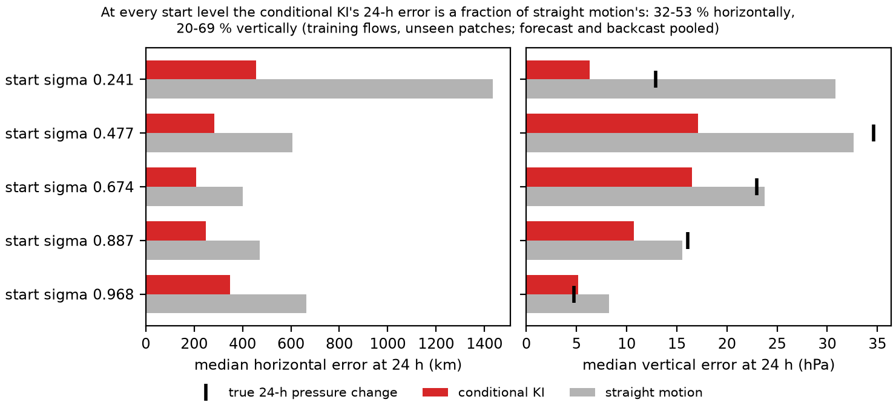

# 02_dinosaur — conditional forecasts and backcasts of 3-D parcel tracks in baroclinic life cycles

Three-dimensional version of `01_bve`. Air parcels are released in compact patches at five model levels, from the
surface layer to about 240 hPa, into baroclinic-wave life cycles of the JAX primitive-equation core Dinosaur, set up
as in Thorncroft, Hoskins & McIntyre (1993; THM93): T95, the 15 sigma levels of THM93, dry and frictionless, a
Simmons & Hoskins (1977) jet with or without THM93's barotropic shear (LC1, LC2 with lobes, LC2 with a polar cap),
perturbed by the most unstable normal mode of one zonal wavenumber. LAGRANTO computes full 3-D tracks. A context
transformer predicts the acceleration and velocity score of the Kinematic Interpolant paper from the state of a
parcel and the observed tracks of the other parcels of its patch; two tasks, as in `01_bve`:

- **conditional forecast**: the patch was observed for the 48 h before the anchor time, every parcel is unobserved
  after it; target parcels (not in the context) are integrated forward 6–24 h;
- **conditional backcast**: observed for the 48 h after the anchor; targets are integrated backward 6–24 h.

The flows differ in jet speed (35–60 m/s), basic-state type, mode wavenumber (4–8) and mode amplitude (0.5–2 hPa):
48 training combinations and 8 unseen ones (4 held-out combinations inside those ranges, 4 outside them) were drawn;
52 ran (46 training, 6 unseen; see "Basic states with strong jets"). `PLAN.md` holds the design.

## Pipeline

| Step | Script | Output |
| --- | --- | --- |
| 0 | `scripts/00_flows.py` — draws the 48 training and 8 unseen configurations (fixed seed) | `configs/flows.json` |
| 1–3 | `scripts/01_basic_state.py`, `02_normal_mode.py`, `03_life_cycle.py` (driver `scripts/run_all.py`, GPUs 1–2) — balanced basic state, normal mode of wavenumber m, 15-day life cycle with hourly output | `data/basic_*.nc`, `data/mode_*.npz` |
| 5 | `scripts/05_check_figure.py` — eddy kinetic energy of all flows, LC1 and LC2 maps on day 7 | `figures/check_eke_omega.png` |
| 4 | `scripts/04_omega_regrid.py` — omega from sigma-coordinate continuity, regridding to 1° (0–90°N with the pole row) | `data/dino_<flow>.nc`: hourly u, v, omega, T, ps on the 15 levels |
| 10–12 | `scripts/run_tracks.sh`: `10_lagranto_input.py` (3-D P files), `11_tracks.py` (5 levels × 8 patches × 1000 parcels, start pressure σ·ps, `caltra` 3-D with `-j`, 1-min step, wfactor checked = 1), `12_dataset.py` (x, y polar-stereographic, z = −7 km ln(p/1000 hPa); spline velocity and acceleration, hourly) — windows starting on days 2 and 8 | `data/tracks_<flow>_w<k>_l<level>.npz` |
| 20 | `scripts/20_train_context.py` (`scripts/run_context.sh 1,2`, `torchrun` DDP) — training patches 0–5, validation patch 6 | `outputs/models/context_ki_3d.pt`, live panels in `outputs/logs/` |
| 21 | `scripts/21_eval_context.py` — patch 7 of the training flows and every patch of the unseen flows; anchors 48/72/96 h; horizontal (km) and vertical (hPa) errors | `outputs/eval/context_ki_3d.csv.gz` |
| 22 | `scripts/22_figures.py` | `figures/f1_conditional_ki_3d.png`, `figures/f2_by_level.png` |
| 23 | `scripts/23_movies.py` (`FFMPEG` = ffmpeg with libx264) | `figures/movies/<case>.mp4` |
| — | `ki_dinosaur.ipynb` (written by `scripts/build_ki_dinosaur_notebook.py`) | — |



## The model

`scripts/ctx_model.py`, `scripts/ctx_data.py`: the `01_bve` context model with a 3-D state. Tokens and queries are
(time from the anchor, x and y relative to the patch centroid, absolute height z, sin latitude, u, v, w) with Fourier
features; per-axis scales: positions 1000/1000/10 km, velocities 100/100/0.05 km/h, accelerations 10/10/0.005 km/h².
Perceiver encoder (width 384, 96 latents, 6 layers) over 192 context parcels every 3 h, cross-attention decoder
(3 layers). KI training targets with rotating Gaussian noise of 5 km horizontally and 10 m vertically (time scale 6 h).
Normalized target accelerations are clipped at ±30: near-surface parcels that `caltra -j` lifts back above the ground
have a kink whose spline acceleration is not physical (normalized values up to about 2000 against a 99th percentile of
5–14).

## Basic states with strong jets

Every basic state with a jet of 50 m/s or more has potential temperature decreasing with height between sigma 0.197
and 0.241 within about 20° of the equator (dθ/dln p from +3.1 K at 47 m/s to −19.6 K at 65 m/s), a by-product of
building the temperature from thermal-wind balance for a scaled-up jet. For four flows the power iteration then
converges to a fast equatorial mode and the integration fails in the first hour at any time step tried (600, 300,
150 s): two training flows (LC2 polar cap, 60 m/s, m 4 and 5) and two unseen ones (LC2 lobes 65 m/s m5; LC1 65 m/s
m3). They were removed (`REMOVED` in `scripts/00_flows.py`); `configs/flows.json` lists the 52 flows used. The other strong-jet flows (22 training, 2 unseen) ran normally in mid-latitudes (tropical
upper-level wind below 21 m/s through day 15; the patches start at 30–65°N). Six wavenumber-4 modes did not converge
in 40 iterations, and one flow (LC2 polar cap, 35 m/s, m 4, amplitude 0.5) hardly develops.

## Results

46 training flows (patches 0–5: 2.8e6 training tracks of the 3.7e6 in these flows), 60 000 steps × 32 samples per
GPU on 2 GPUs (DDP, about 90 min), best
validation at step 40 000; 18.1 M parameters. Test: 64 target parcels per patch (not in the context), anchors
48/72/96 h, both windows and all five start levels; 460 unseen patches of the training flows, 80 patches per unseen
flow (`outputs/eval/context_ki_3d.csv.gz`). Medians; `straight` = straight motion at the anchor velocity.



| case | forecast 6 / 12 / 24 h (km) | straight | 24 h (hPa) KI / straight | backcast 6 / 12 / 24 h (km) | straight | 24 h (hPa) KI / straight |
| --- | --- | --- | --- | --- | --- | --- |
| training flows, unseen patches | 24 / 88 / 331 | 53 / 208 / 749 | 11.7 / 22.2 | 24 / 84 / 284 | 51 / 193 / 662 | 8.7 / 18.7 |
| unseen, inside the ranges (4 flows) | 18 / 66 / 248 | 33 / 132 / 497 | 7.8 / 14.4 | 17 / 58 / 188 | 34 / 126 / 448 | 5.0 / 12.1 |
| unseen, jet 30 m/s | 10 / 37 / 147 | 14 / 56 / 225 | 4.7 / 5.5 | 9 / 32 / 113 | 14 / 54 / 199 | 2.9 / 5.3 |
| unseen, wavenumber 9 | 13 / 42 / 153 | 17 / 67 / 244 | 6.9 / 16.1 | 13 / 39 / 124 | 20 / 70 / 239 | 4.4 / 13.2 |

- The model transfers to flows it never saw: its 24-h horizontal error is 57 % below straight motion on unseen
  patches of the training flows, 54 % below in the unseen flows inside the training ranges and 41 % below outside
  them (forecast and backcast pooled). The unseen flows outside the ranges are slower (24-h displacement 708–927 km
  against 1275 km), so all their errors are smaller.
- Backcasts are better than forecasts at 12 and 24 h in every case, horizontally and vertically.
- Vertically, the KI halves the 24-h pressure error of straight motion in the training flows, but at 6 h it gains
  little (2.2 against 2.6 hPa), and in the slow 30 m/s flow it is slightly worse at 6 h (1.1 against 0.7 hPa).



- By start level (training flows, unseen patches): the KI's 24-h error is 32–53 % of straight motion's horizontally
  and 20–69 % vertically. The gain is largest at sigma 0.241 (horizontal 456 against 1435 km). Near the surface
  (sigma 0.968) the KI's vertical error (5.1 hPa) exceeds the median true 24-h pressure change (4.7 hPa): there,
  predicting no vertical motion would do better.

## Test movies

`scripts/23_movies.py` writes one movie per test case: forecast (left) and backcast (right) of 12 target parcels
started at sigma 0.477 (window 0, anchor 96 h, the breaking phase), over relative vorticity (colour), streamfunction
(contours) and wind (arrows) on that level, and below, their pressure against time. Grey: the other parcels'
observed tracks (the model's input); blue: truth; red dashed: model.

| case | movie |
| --- | --- |
| training flows, unseen patch (LC1, 50 m/s, m 6) | [`training_flows_unseen_patch.mp4`](figures/movies/training_flows_unseen_patch.mp4) |
| unseen, inside the ranges (LC2 polar cap, 50 m/s, m 6) | [`unseen_inside_the_training_ranges.mp4`](figures/movies/unseen_inside_the_training_ranges.mp4) |
| unseen, jet 30 m/s | [`unseen_outside_jet_30_m_s.mp4`](figures/movies/unseen_outside_jet_30_m_s.mp4) |
| unseen, wavenumber 9 | [`unseen_outside_wavenumber_9.mp4`](figures/movies/unseen_outside_wavenumber_9.mp4) |

## Tests

```bash
micromamba run -n kinematic_interpolants python -m pytest -q tests/test_context.py
micromamba run -n thm93_dinosaur python -m pytest -q tests/test_model_setup.py tests/test_omega_regrid.py
```

The static-stability check of the basic states is marked as an expected failure for jets of 50 m/s or more (see
"Basic states with strong jets").
