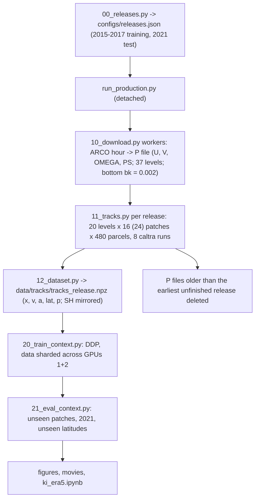

# 03_era5 plan — conditional forecasts and backcasts of 3-D parcel tracks in ERA5

Same design as `02_dinosaur` (context transformer reading the other parcels' observed tracks; conditional forecast
and backcast, 6–24 h), now on reanalysis winds over the whole globe.

## Winds
- ERA5 from Google's ARCO store `gs://gcp-public-data-arco-era5/ar/full_37-1h-0p25deg-chunk-1.zarr-v3`, read
  anonymously (gcsfs `token="anon"`): 0.25°, global (1440 × 721), hourly, all 37 pressure levels (1–1000 hPa);
  u, v, vertical velocity (Pa/s), surface pressure.
- One LAGRANTO P file per hour (U, V, OMEGA, PS; 465 MB). Pressure levels: ak = p, bk = 0, except the bottom level,
  which gets bk = 0.002 and ak = p − 0.002 × 1000 hPa: with every bk = 0 the IVE reader skips PS and puts the ground
  at 1000 hPa everywhere. Longitude ring closed at 360° (caltra then treats the domain as periodic).
- Downloads run at about 150 MB/s (the network link is the limit), so one year of u, v, ω, ps (4.08 TB) takes
  about 7.6 h; P files are 11.2 GB per day of data.

## Releases and tracks
- Training period 2015-01-01 to 2017-12-31, test year 2021; a release every 5 days, release hour cycling through
  00, 06, 12, 18 UTC; window 157 h (6.5 days) from the release, as in 02.
- Per release: 20 start levels sigma × ps, sigma = 0.967, 0.93, 0.887, 0.85, 0.80, 0.75, 0.71, 0.674, 0.62, 0.57,
  0.52, 0.477, 0.43, 0.38, 0.33, 0.285, 0.241, 0.20, 0.15, 0.10 (02's five levels included); 16 patch centres per
  level (8 per hemisphere, 25–70°, at least 2000 km apart, a new draw per level); 480 parcels in a 300-km disk per
  patch. Test releases add 8 patches per level at latitudes never used in training (per hemisphere two at 10–25° and
  two at 70–85°).
- caltra, full 3-D, `-j`, 1-min step, 10-min output, wfactor 1 checked; one release split into 8 caltra runs of
  patch-ordered parcels, each in its own directory with links to the P files.
- Dataset per release: polar-stereographic x, y (km) and z = −7 km ln(p/1000 hPa); spline velocity and acceleration,
  hourly; float32 (as 02). Southern-hemisphere tracks are mirrored to the north (latitude → −latitude, so v changes
  sign), which maps a Southern-Hemisphere flow onto an equally valid Northern-Hemisphere one; a hemisphere flag is
  kept.
- Totals: 219 training releases × 153 600 = 3.36e7 tracks (2.52e7 in training patches); 73 test releases ×
  230 400 = 1.68e7 tracks; at 6.49 kB per track about 330 GB.

## Batches, disk and time
- Rolling batches: hours are downloaded in time order by a pool of workers while released windows are tracked;
  a release is tracked as soon as its 157 P files exist; P files older than the earliest unfinished release are
  deleted; downloads pause when the P files on disk exceed 400 GB.
- Disk (roger ≤ 1–1.5 TB): 01 + 02 about 194 GB; ERA5 tracks about 330 GB; P files at most 400 GB.
- Time: about 30 h of downloading for 4 years (2015–2017, 2021); caltra about 1.8 core-hours per release (runs
  alongside); training about 6 h.

## Learning
- Model and losses of 02 (Perceiver context encoder, cross-attention decoder; acceleration and velocity-score heads;
  rotating Gaussian noise); width 512.
- Split by patch within each training release: NH patches 0–5 and SH 8–13 train, 6 and 14 validation, 7 and 15
  test (unseen patches).
- DDP on GPUs 1+2 with the training set sharded by rank, float32 x, v, a on the GPUs (2.52e7 tracks, about 71 GB per
  GPU; measured limit 1.38e7 tracks per A100 next to a d = 512 training step); sin(latitude) is computed from x.
- Tests: unseen patches of the training releases; 2021 (unseen year); 2021 patches at unseen latitudes; anchors
  48/72/96 h; horizontal and vertical errors; straight motion as reference; by start level and hemisphere.
- Deliverables: `ki_era5.ipynb`, README with Mermaid chart, figures with fresh-reader audits, movies of test cases,
  tests, push.

