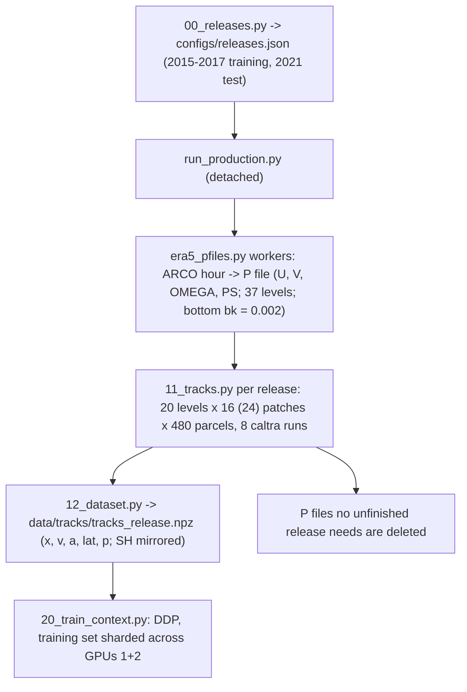

# 03_era5 — conditional forecasts and backcasts of 3-D parcel tracks in ERA5

The `02_dinosaur` experiment on reanalysis winds. Air parcels are released in compact patches at 20 levels, from the
surface layer to about 100 hPa, over both hemispheres, every 5 days of 2015–2017 (training) and 2021 (test).
LAGRANTO computes full 3-D tracks from hourly ERA5 at 0.25° on its 37 pressure levels. A context transformer predicts
the acceleration and velocity score of the Kinematic Interpolant paper from the state of a parcel and the observed
tracks of the other parcels of its patch; two tasks, as in `02_dinosaur`:

- **conditional forecast**: the patch was observed for the 48 h before the anchor time; target parcels (not in the
  context) are integrated forward 6–24 h;
- **conditional backcast**: observed for the 48 h after the anchor; targets are integrated backward 6–24 h.

Tests: unseen patches of the training releases, the unseen year 2021, and patches released in 2021 at latitudes
never used in training (10–25° and 70–85°). `PLAN.md` holds the design and the measured resource budget.

## Winds

ERA5 is read anonymously from Google's ARCO store (`full_37-1h-0p25deg-chunk-1.zarr-v3`): u, v, vertical velocity
and surface pressure, hourly, 0.25°, global, 37 levels. Each hour becomes one LAGRANTO P file (465 MB). On pure
pressure levels (bk = 0) LAGRANTO's reader ignores the surface pressure and puts the ground at 1000 hPa everywhere;
the writer `write_pfile_plev` (`lagranto/python/lagranto_io.py`) therefore gives the bottom level bk = 0.002, which
makes caltra read PS and keep parcels above the terrain (`lagranto/tests/test_lagranto_plev.py`). Downloading is
the slowest step (about 150 MB/s, 7.6 h per year of data), so the P files are streamed: written in time order,
used, and deleted.

## Pipeline

| Step | Script | Output |
| --- | --- | --- |
| 0 | `scripts/00_releases.py` — 220 training releases (2015–2017) and 73 test releases (2021), every 5 days, hour cycling 00/06/12/18 UTC; 20 levels, 16 patches per level (8 per hemisphere, 25–70°), 8 more at unseen latitudes in 2021, 480 parcels per patch | `configs/releases.json` |
| 1 | `scripts/run_production.py` (detached) — downloads hours in time order with `scripts/era5_pfiles.py` workers, at most 400 GB of P files ahead of the earliest unfinished release; tracks each release once its 157 P files exist; deletes P files no unfinished release needs; resumes from finished releases | `data/pfiles/` (transient), `outputs/logs/production/` |
| 2 | `scripts/11_tracks.py` — seeds the patches (start pressure σ × bilinear PS), runs 8 caltra jobs of patch-ordered parcels (full 3-D, `-j`, 1-min step, 10-min output, wfactor 1 checked) | `data/lagranto/<release>.npz` (transient) |
| 3 | `scripts/12_dataset.py` — Southern-Hemisphere patches mirrored to the north; polar-stereographic x, y and z = −7 km ln(p/1000 hPa); spline velocity and acceleration, hourly, float32 | `data/tracks/tracks_<release>.npz` |
| 20 | `scripts/20_train_context.py` (`torchrun`, DDP) — training set sharded by release across GPUs, float32 x, v, a on the GPUs | `outputs/models/context_ki_era5.pt`, live panels in `outputs/logs/` |



## The model

`scripts/ctx_model.py` is the `02_dinosaur` model (width 512 here). `scripts/ctx_data.py` keeps only x, v, a in
float32 on the GPU (sin latitude follows from x) and draws context and query parcels disjointly. Each rank loads
only its shard of releases, so two A100s hold the 2.5e7 training tracks (about 71 GB each; the measured limit next to
a training step is 1.38e7 tracks per GPU).

## Tests

```bash
micromamba run -n kinematic_interpolants python -m pytest -q tests/test_pipeline.py
```
