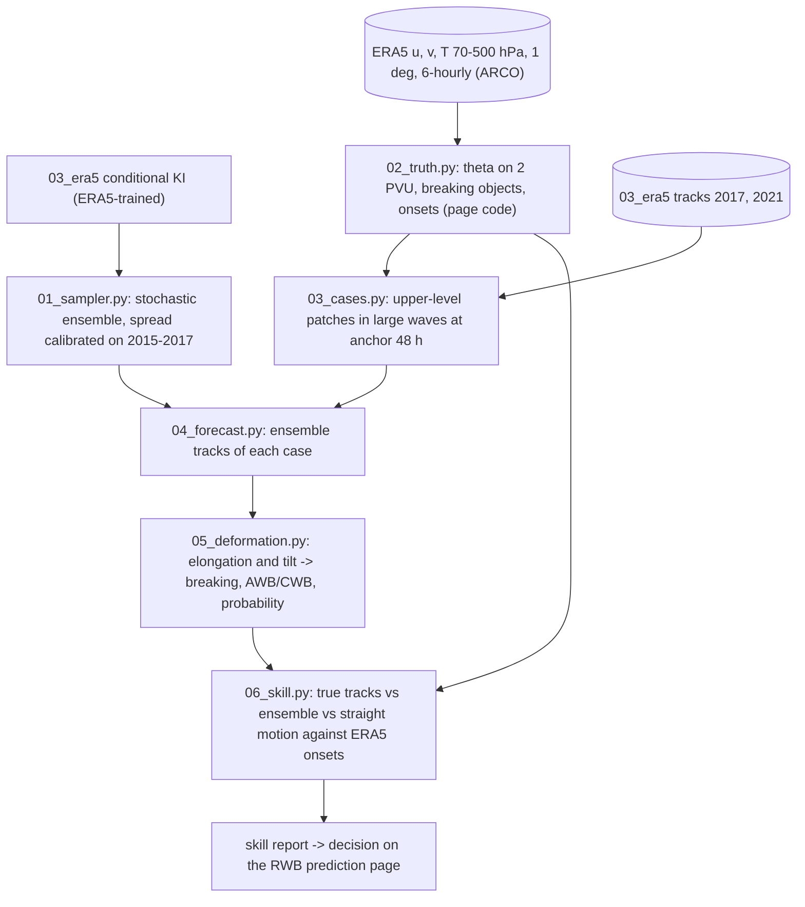

# 04_rwb_forecast plan — will a wave break in the next 12–24 h, anticyclonically or cyclonically?

Use the conditional Kinematic Interpolant trained on ERA5 (`03_era5`) as a forecast-free predictor of Rossby wave
breaking: release parcel patches in the largest waves on θ at 2 PVU, forecast their next 12–24 h as a stochastic
ensemble from the observed past 48 h of their own tracks, and read breaking and its type from how each forecast
patch is stretched. Offline first (skill against ERA5), then the RWB prediction page, where this method takes the
place of the current "Opus model" and is compared with GFS.

## Ensemble forecasts
- Model: `03_era5/outputs/models/context_ki_era5.pt` (per-axis scales in `03_era5/configs/scales.json`).
- Stochastic sampler (as in the Kinematic Interpolant code): x' = v, dv = [a + (ε²/2) s / σ_v] dt + ε dW, with a
  the predicted acceleration, s the scaled velocity-score head and σ_v = s_x · π√3 / δ the training noise in
  velocity (s_x = 5, 5, 0.01 km; δ = 6 h). ε (per axis, in units of σ_v per √h) is chosen on the 2015–2017
  validation patches so that the ensemble spread matches the error of the ensemble mean at 12 and 24 h; checked
  on 2021.

## Breaking from patch deformation
- At time t the target parcels of a patch (ensemble mean per parcel, or each member) give a 2×2 covariance of their
  east/north offsets from the centroid; elongation E = √(λ1/λ2) and long-axis angle α from east, folded to
  (−90°, 90°]. Northern Hemisphere: α > 0 (long axis SW–NE, anticyclonic shear) → anticyclonic breaking (AWB);
  α < 0 (NW–SE, cyclonic shear) → cyclonic (CWB).
- Call: breaking when E at +24 h exceeds E at the anchor time by a factor G; the factor is chosen on 2017 and the
  skill is reported on 2021. Probability = share of ensemble members that call breaking; type by the members' α.

## Truth and offline skill (ERA5)
- θ on 2 PVU and PV on 330/350 K every 6 h at 1° from ERA5 u, v, T on 70–500 hPa, breaking objects and onsets with
  the RWB prediction page's code (`surfaces.py`, `events.py`, copied).
- Cases: upper-level patches (start sigma 0.33, 0.285, 0.241) of the 2017 and 2021 releases at anchor 48 h
  (context 0–48 h), restricted to patches in large waves (the page's wave-amplitude field at the anchor time).
  A case is a breaking when an onset on θ at 2 PVU lies within 1000 km of the patch's path within 24 h; its type
  is the onset's.
- Predictors scored on the same cases: true tracks (upper bound of this classifier), the ensemble (this method),
  straight motion from the anchor velocities (no learning). Scores: hit rate, false-alarm ratio, Peirce skill score,
  type accuracy of the hits; reliability of the ensemble probability.

## Page (only if the offline test shows skill)
- Daily on GitHub Actions: GFS hourly winds (f000–f005 of the last 8 cycles) → LAGRANTO tracks of patches released
  48 h before the issue time → patches in the top waves at the issue time → ensemble forecasts (CPU) → breaking calls
  and alarm regions scored like the other methods against ERA5T. GFS comparison: the same patches carried by GFS
  forecast winds (f000–f024). Per issue time, for each selected wave, two rows (this method | GFS) × 0/12/24 h maps.

