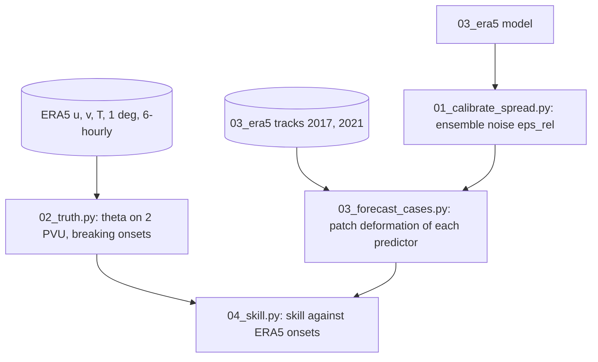

# 04_rwb_forecast — can forecast parcel patches tell whether a wave will break within 24 h?

A test of a forecast-free predictor of Rossby wave breaking: the conditional Kinematic Interpolant of `03_era5`
forecasts how a patch of air parcels near the tropopause moves and stretches over the next 24 h, and breaking is
called when the patch is stretched strongly, anticyclonic (AWB) if its long axis tilts SW–NE and cyclonic (CWB) if
NW–SE. Truth: onsets of breaking on θ at 2 PVU in ERA5, detected with the code of the RWB prediction page (overturning
circumpolar contours, every 6 h at 1°). **Result: the rule has no skill, even when it is applied to the true tracks.**

## Steps

| Step | Script | Output |
| --- | --- | --- |
| 1 | `scripts/01_calibrate_spread.py` — stochastic ensemble (`scripts/kiforecast.py`): dv = [a + (ε²/2) s / σ_v] dt + ε dW; ε chosen on 2015–2017 validation patches so that the 24-h spread matches the rms error of the ensemble mean | `outputs/calibration.csv`, `configs/ensemble.json` |
| 2 | `scripts/02_truth.py` — ERA5 u, v, T on 70–500 hPa every 6 h at 1° (ARCO), θ on 2 PVU, breaking objects and onsets (`scripts/rwb/`: copies of the page's `config`, `surfaces`, `events`, `predictors`) | `data/truth/` |
| 3 | `scripts/03_forecast_cases.py` — Northern-Hemisphere patches at start sigma 0.33, 0.285, 0.241, patch ids not used in training, anchors 48/72/96 h: true tracks, straight motion, deterministic model, ensemble; patch elongation and tilt at 0, 12, 24 h | `outputs/cases_<year>.npz` |
| 4 | `scripts/04_skill.py` — thresholds chosen on 2017, scores on 2021; reference: the page's wave amplitude at the patch | `outputs/skill_*.json` |

## Results

- Ensemble: ε = 1.5 σ_v per √h; on the validation patches the ensemble mean's median 24-h error is 275 km against
  338 km for the deterministic forecast; spread / rms error 0.79 (the largest ratio reached over ε).
- Truth: 1545 onsets in 2017 (931 AWB, 614 CWB), 1525 in 2021 (916 AWB, 609 CWB). A case is a breaking when an onset
  lies within 1000 km of the patch within 24 h (base rate 0.07).
- Peirce skill score against ERA5 onsets, 2021 (thresholds from 2017; 5256 cases): true tracks −0.00, straight motion
  −0.04, model −0.00, ensemble mean 0.00, ensemble −0.00; wave amplitude 0.10.
- The model reproduces the true stretching (Peirce skill score against the calls from the true tracks: ensemble mean
  0.75, model 0.50, straight motion 0.68), so the rule, not the model, fails.
- 2017, true tracks: area under the ROC curve of the elongation at 24 h 0.41 and of its growth 0.45 (breaking cases
  are slightly less stretched), tilt change 0.62, latitude 0.64, wave amplitude 0.59; AWB/CWB from the tilt 58 %
  correct (AWB share 56 %).
