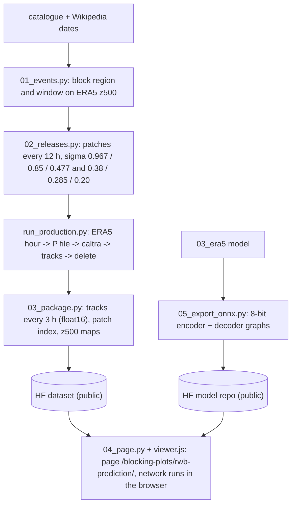

# 05_blocking_viewer plan — launch air parcels anywhere in a blocking event and see their ±24 h tracks

An interactive page that replaces the RWB prediction page (`/blocking-plots/rwb-prediction/`): choose a blocking
event, a time in its life cycle, a level between 400 and 200 hPa and a place; the conditional Kinematic Interpolant
of `03_era5` (Jiang, Marzouk, Bose & Pooladian, arXiv:2610.22519, conditioned on the observed motion of nearby
parcels) forecasts and backcasts a small cloud of parcels launched there for 24 h, as an ensemble, next to the true
ERA5 tracks.

## Why a precomputed track cloud
The model reads no wind field: to forecast (backcast) parcels launched at time t it needs the tracks of ~192 nearby
parcels over the 48 h before (after) t. Each event therefore gets a dense cloud of ERA5 parcel tracks (LAGRANTO),
which supplies the context of any launch.

## Events
- 2010 Russia: catalogue blocks 880 and 881 (ERA5 TempestExtremes, z500 anomaly): 2010-07-10 22 UTC to 07-20 23 UTC
  and 2010-07-22 03 UTC to 08-13 19 UTC, near 57 N, 32-47 E.
- 2019 North Atlantic: catalogue block 1312: 2019-07-21 19 UTC to 08-05 08 UTC, near 68 N, 12 W.
- 2021 Pacific Northwest heat wave: 2021-06-25 to 07-07 (Wikipedia; heat dome over the British Columbia Interior on
  June 28, "a massive Rex block").
- 2025 Southern California wildfires: 2025-01-07 to 01-31 (Wikipedia; Santa Ana windstorm January 7-8).
- 2026 Greenland high during the North American winter storm of 2026-01-23 to 01-27 (Wikipedia; the page does not
  mention the high).
- Region and life-cycle window of each event (and the block of the last three) are located on ERA5 500-hPa height
  before any tracks are computed (`01_events.py`, maps checked by eye).

## Track cloud per event
- ERA5 0.25° hourly, 37 levels, streamed as for `03_era5` (P files with the bottom-level bk fix, deleted after use).
- Patches as in training: 300-km disks of 480 parcels, released every 12 h from 4 days before the window to its end,
  on a grid of centres covering the region and 40° upstream, at six start levels (training levels of 03_era5): sigma
  0.38, 0.285, 0.20 (about 380, 285 and 200 hPa at sea-level pressure) and, in a second release per time (`_lower`),
  0.967, 0.85, 0.477 (just above the ground, about 850 and 480 hPa); parcels then move in 3-D; caltra 157 h, -j,
  1-min step.
- Package per event (public Hugging Face dataset): positions and velocities of every parcel every 3 h (float16, one
  row per patch so that a page can fetch a single patch with an HTTP range request), patch centroids, and the 500-hPa
  height and its departure from the zonal mean every 6 h at 1° for the maps.

## Inference in the browser
- The network is exported to two ONNX graphs (encoder, decoder) with 8-bit weights of the matrix products per output
  channel (40 MB, public model repository) and runs in onnxruntime-web (WebAssembly, one thread).
- A click (event, time, level, lat, lon) -> among the patches of that level (forecast:
  released 48-132 h earlier; backcast: 24-108 h earlier), of the six whose centroids are nearest the point, the one
  whose 16th-nearest parcel is closest to it gives the 192 context parcels; its 16 parcels nearest the point are
  launched; 16 members of the stochastic ensemble (eps_rel = 1.5 from `04_rwb_forecast/configs/ensemble.json`)
  are integrated forward and backward 24 h in 10-min steps and drawn hour by hour. About 30 s
  per launch.
- `scripts/06_check_onnx.py` checks the graphs against PyTorch on 2021 tracks with the same integration as the page.

## Page and retirement
- `_pages/rwb-prediction.html` replaced (same URL): event menu, time slider, level, longitude-latitude map with the
  500-hPa height, click to launch, ensemble members and mean, pressure against time; journal style,
  every term defined. Nothing is written to the browser's caches; the network and event data are dropped when the
  page is left.
- Retired: `.github/workflows/rwb_prediction.yml`, `pipelines/rwb_prediction/`, the Blocking Plots card text; the
  Hugging Face dataset `yanxingjianken/rwb-prediction` is deleted when the new page goes live.

