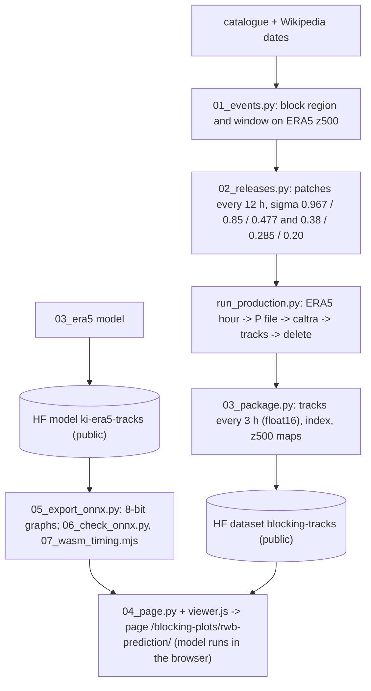

# 05_blocking_viewer — launch air parcels in a blocking event and see their ±24 h tracks

Builds the data, the in-browser model and the page of the interactive viewer at `/blocking-plots/rwb-prediction/`
of the Blocking Plots site: choose a blocking event, a time, a start level (just above the ground, or about 850, 480,
380, 285 or 200 hPa) and a point; the conditional Kinematic Interpolant of `03_era5` forecasts and backcasts the 16
tracked ERA5 parcels nearest the point for 24 h as an ensemble (the page draws the network's tracks only and says how
far from the point the launched parcels start). The model reads no wind field, so every event comes with a dense cloud
of true tracks that supplies the context (48 h of observed tracks of 192 nearby parcels) of any launch. Everything the
page uses is public on Hugging Face and runs in the visitor's browser; no server is involved.

| Event | Life-cycle window | Basis |
| --- | --- | --- |
| Russia, summer 2010 | 2010-07-22 to 08-13 | ERA5 TempestExtremes catalogue block 881 |
| North Atlantic, summer 2019 | 2019-07-21 to 08-05 | catalogue block 1312 |
| Pacific Northwest heat dome, 2021 | 2021-06-25 to 07-03 | Wikipedia dates; ERA5 500-hPa height |
| California wildfires, January 2025 | 2025-01-05 to 01-16 | Wikipedia dates; ERA5 500-hPa height |
| Greenland high, January 2026 winter storm | 2026-01-20 to 01-27 | Wikipedia storm dates; ERA5 500-hPa height |

## Steps

| Step | Script | Output |
| --- | --- | --- |
| 1 | `scripts/01_events.py` — 500-hPa height and its departure from the zonal mean every 6 h over a search area per event (`configs/events_search.json`); maps checked by eye; windows and regions in `configs/events.json`, which also lists one or two peer-reviewed studies of each event (blocking studies first; DOIs checked against Crossref) for the page | `figures/events_<event>.png` |
| 2 | `scripts/02_releases.py` — releases every 12 h from 4 days before each window, patch centres ~1000 km apart over the region and 40° upstream, six start levels in two releases per time (sigma 0.38 / 0.285 / 0.20, and `_lower` 0.967 / 0.85 / 0.477), each with its own seed; 480 parcels in 300-km disks | `configs/releases.json` |
| 3 | `scripts/run_production.py` with `era5_pfiles.py`, `11_tracks.py`, `12_dataset.py` (copies of the `03_era5` scripts) — ERA5 0.25° hourly → P files → caltra → hourly tracks; P files deleted after use | `data/tracks/` |
| 4 | `scripts/03_package.py` — per event: positions and velocities of all parcels every 3 h (float16, memory-mappable), patch index, 500-hPa maps | `pkg/<event>/` → Hugging Face dataset `yanxingjianken/blocking-tracks` |
| 5 | `scripts/05_export_onnx.py` — encoder and decoder graphs for onnxruntime-web, 8-bit weights of the matrix products per output channel; `scripts/06_check_onnx.py` — the same integration as the page in NumPy + onnxruntime against PyTorch (`space/kimodel.py`, `space/core.py`: Python reference of the launch) on 2021 tracks; `scripts/07_wasm_timing.mjs` — time per call in WebAssembly | `hf_model/onnx/` → public Hugging Face model `yanxingjianken/ki-era5-tracks`, `outputs/wasm_timing.json` |
| 6 | `scripts/04_page.py` (site clone in `SITE_REPO`) — fills `page/rwb-prediction.template.html` with numbers from the result files and inlines `page/viewer.js` (fetches one patch with an HTTP range request, builds the context, integrates the ensemble in the browser; longitude–latitude map with the latitude stretched by 1 / cos of the middle latitude, at most 2; nothing is written to the browser's caches, and the network and event data are dropped when the page is left) | site `_pages/rwb-prediction.html` |

Hosting a Python (Gradio) Space on Hugging Face's free hardware now needs a paid subscription, so the model runs in
the visitor's browser. On 36 patches of 2021 (16 parcels each, 16 members) the 24-h ensemble-mean median errors are
247 / 180 km (forecast / backcast) in PyTorch, 236 / 191 km with the full-precision graphs and 254 / 190 km with the
8-bit graphs the page uses (40 MB); a launch takes about 30 s in onnxruntime-web on one core. Headless-Chrome launches of the built page take 18-32 s.

The track clouds hold 27,744 patches (13.3 million parcels) over the five events and six start levels; packages on the
dataset are 1.0-2.5 GB per event, of which a launch reads about 2 MB. Over each event region, at three times, 70-99 %
of the points of a 2 deg x 3 deg grid have at least 16 tracked parcels of one patch within 300 km (the condition for a
launch) in both directions; near the surface 86-97 %, since slow parcels stay near their release centres. Elsewhere
the page reports that too few parcels are near the point.
