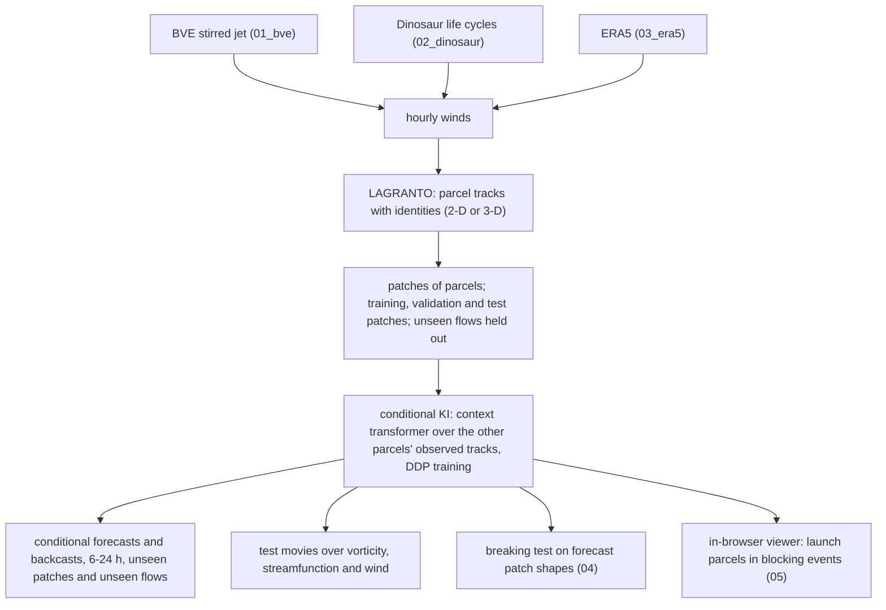

# Learning to fill and forecast air-parcel tracks with Kinematic Interpolants

Can a network that reads the observed tracks of a patch of air parcels forecast and backcast the tracks of other
parcels of that patch, 6–24 h beyond the observed period, in flows it has never seen? The model is the Kinematic
Interpolant (KI) of Jiang, Marzouk, Bose & Pooladian, *Learning smooth dynamics via Kinematic Interpolants*,
arXiv:2610.22519 (2026): second-order dynamics x' = v, v' = a(t, x, v) with a learned acceleration field and a
learned velocity score, here conditioned on the other parcels' observed tracks. The trajectories come from LAGRANTO (Sprenger & Wernli 2015, doi:10.5194/gmd-8-2569-2015)
run on winds of models of increasing realism, with Rossby-wave breaking in mind.

| Folder | What it is | Status |
| --- | --- | --- |
| [`01_bve/`](01_bve/) | 2-D tracks in 13 stochastically stirred barotropic jets on the sphere (torch-harmonics) | done |
| [`02_dinosaur/`](02_dinosaur/) | 3-D tracks in 52 baroclinic life cycles of the JAX dynamical core Dinosaur | done |
| [`03_era5/`](03_era5/) | 3-D tracks in ERA5 (0.25°, 37 pressure levels, both hemispheres; 2015–2017 training, 2021 test); self-contained notebook `ki_era5.ipynb` | done |
| [`04_rwb_forecast/`](04_rwb_forecast/) | does the forecast deformation of a patch predict Rossby-wave breaking 12–24 h ahead? (fit 2017, test 2021) | no skill, even with the true tracks |
| [`05_blocking_viewer/`](05_blocking_viewer/) | track clouds of five blocking events, the network for the browser and the interactive viewer of the Blocking Plots site | live |
| [`lagranto/`](lagranto/) | LAGRANTO.ecmwf source (ETH public SVN, revision 47, GPLv3) with a gfortran build script and Python I/O | built |
| `ki/` | upstream KI code (git submodule, github.com/Submobile01/KinematicInterpolant, MIT) | reference |

Environment: micromamba env `kinematic_interpolants` (Python 3.12, torch with CUDA, torch-harmonics 0.6.5); LAGRANTO
is compiled with gfortran and netcdf-fortran (`bash lagranto/build.sh`).

Licences: `lagranto/` is GPLv3 (its `LICENSE.pdf`); `ki/` is the upstream MIT-licensed code; everything else is
MIT (`LICENSE`).
