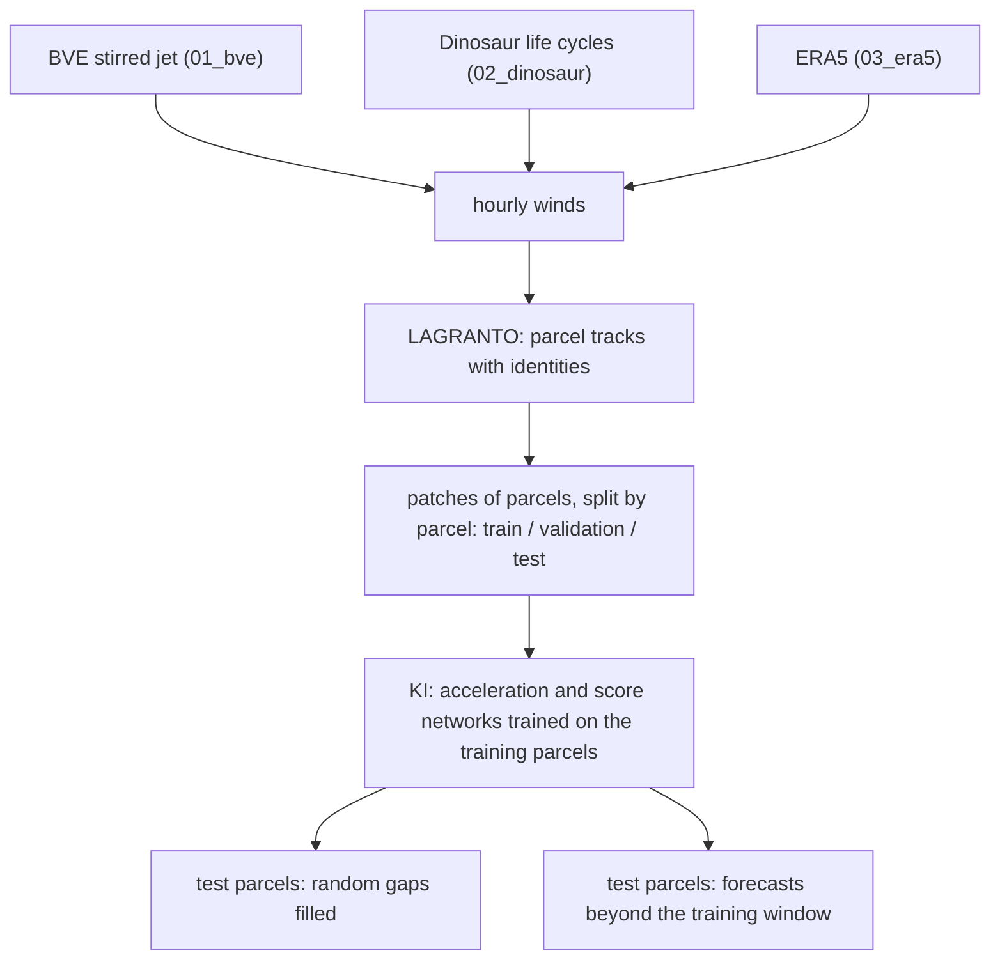

# Learning to fill and forecast air-parcel tracks with Kinematic Interpolants

Can a network trained on part of a population of air-parcel trajectories reconstruct any missing segment of a
parcel it has never seen, and how far beyond the observed period can it forecast? The model is the Kinematic
Interpolant (KI) of Jiang, Marzouk, Bose & Pooladian, *Learning smooth dynamics via Kinematic Interpolants*,
arXiv:2610.22519 (2026): second-order dynamics x' = v, v' = a(t, x, v) with a learned acceleration field and a
learned velocity score. The trajectories come from LAGRANTO (Sprenger & Wernli 2015, doi:10.5194/gmd-8-2569-2015)
run on winds of models of increasing realism, with Rossby-wave breaking in mind.

| Folder | What it is | Status |
| --- | --- | --- |
| [`01_bve/`](01_bve/) | 2-D tracks in a stochastically stirred barotropic jet on the sphere (torch-harmonics) | in progress |
| [`02_dinosaur/`](02_dinosaur/) | 3-D tracks in baroclinic life cycles of the JAX dynamical core Dinosaur, several jet configurations | planned |
| [`03_era5/`](03_era5/) | tracks in ERA5 | on hold |
| [`lagranto/`](lagranto/) | LAGRANTO.ecmwf source (ETH public SVN, revision 47, GPLv3) with a gfortran build script and Python I/O | built |
| `ki/` | upstream KI code (git submodule, github.com/Submobile01/KinematicInterpolant, MIT) | reference |

Environment: micromamba env `kinematic_interpolants` (Python 3.12, torch with CUDA, torch-harmonics 0.6.5); LAGRANTO
is compiled with gfortran and netcdf-fortran (`bash lagranto/build.sh`).

Licences: `lagranto/` is GPLv3 (its `LICENSE.pdf`); `ki/` is the upstream MIT-licensed code; everything else is
MIT (`LICENSE`).
