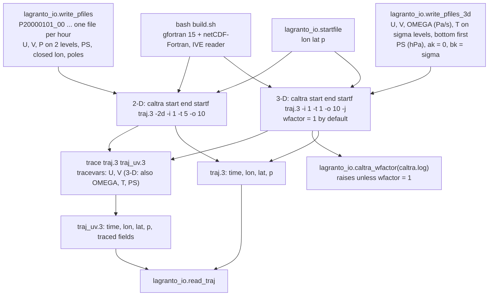

# LAGRANTO for 2-D (model-level) and 3-D trajectories

LAGRANTO is the Lagrangian analysis tool of Michael Sprenger and Heini Wernli (ETH Zurich): `caltra` integrates
parcel trajectories through gridded winds, `trace` interpolates fields along them, `select` filters them.
Reference: M. Sprenger and H. Wernli (2015), The LAGRANTO Lagrangian analysis tool – version 2.0, Geosci. Model Dev. 8, 2569–2586, doi:10.5194/gmd-8-2569-2015.

Here it computes 2-D trajectories from the winds of our barotropic vorticity model (BVE) and 3-D trajectories from
a 15-level sigma-coordinate primitive-equation model (section "3-D trajectories from sigma levels").

## Source

- LAGRANTO.ecmwf trunk, revision 47, from the ETH public SVN https://svn.iac.ethz.ch/pub/lagranto.ecmwf/trunk/,
  licence GPLv3 (`LICENSE.pdf`). This directory is that trunk, flattened (`caltra/`, `trace/`, `lib/`, ...).
- Small source edits, listed with reasons in `PATCHES.md`: binary trajectory output opened an uninitialised
  Fortran unit (`lib/iotra.f`); the 500-input-file limit is raised to 5000 (`caltra/caltra.f`, `trace/trace.f90`);
  `caltra.sh` takes `-wfactor` and no longer guesses the vertical-velocity factor (3-D runs, see "wfactor"), with
  its man page entry. Everything else is unmodified.

## Build

```bash
bash build.sh          # clean rebuild, log in build.log (about 10 s)
export LAGRANTO=/path/to/ki-lagrangian-tracks/lagranto
export PATH=$LAGRANTO/bin:$PATH
```

- Compiler: gfortran 15.3 and netCDF-Fortran 4.6.4 from micromamba env `isca` (`nf-config --fflags/--flibs`;
  `nc-config --flibs` is empty in conda). Binaries carry an rpath to the env's `lib/`, so they run without
  activating the env.
- Flags: `-O -fallow-argument-mismatch`. gfortran 15 turns the legacy rank/type mismatches of the netCDF-2 calls
  into errors; this flag makes them warnings (they are harmless here). Nothing else is needed.
- Built: `lib/*.a` (iotra, ioinp, inter, times, libcdfio, libcdfplus), `caltra`, `trace`, `create_startf`,
  `select`, `density`, `lidar`, the goodies used by the scripts (`gettidiff`, `newtime`, `getvars`, `trainfo`,
  `datelist`, `changet`, `getmima`, `reformat`, `mergetra`, `extract`, `difference`, `timeres`, `list2lsl`,
  `lsl2list`, `lsl2rdf`), and the `bin/` links of `install.csh links`. `build.sh` also sets the exec bits of the
  `.sh` scripts (the export carries none).
- Input reader: `LAGRANTO_INPUT=ive` (default) compiles `lib/ioinp_ive.f`, the IVE netCDF reader. It is the only
  reader that implements `caltra -2d` (the `P.ML` request); the trunk's `lib/ioinp.f` (CF/CDO files with
  hyam/hybm, `LAGRANTO_INPUT=cf`) has no 2-D path. `install.csh` also defaults to the IVE reader.

## P-file format for `caltra -2d`

Each row was checked by running caltra/trace, except the parts marked (source), which are read off `lib/ioinp_ive.f`,
`lib/libcdfio.f` and `caltra.f`.

One netCDF file per time, named `PYYYYMMDD_HH`, all in the directory where `caltra`/`trace` are started.
`python/lagranto_io.py:write_pfiles` writes exactly this.

| Item | Requirement |
|------|-------------|
| Variables | `U`, `V` (m/s) and `P` (hPa, pressure of each model level), dims (CDL order) `(time=1, nz, ny, nx)`; `PS` (hPa) dims `(time=1, 1, ny, nx)`. All `float` (`NC_FLOAT`; (source) `getdef` rejects other types). Dimension names are free. |
| Levels | 2 identical levels. caltra -2d also runs with 1 level, but `trace` stops with "the first tracing variable must be 3D". Level 1 (first in the file) is the bottom: the writer uses P = 600 and 400 hPa, PS = 1000 hPa. Start parcels at a pressure between the levels (500 hPa); the parcel keeps its level index, and the output `p` column is `P` at that index. A start pressure above PS marks the parcel "below topography". |
| Grid | Regular lon-lat. The grid comes from per-variable attributes `xmin`, `xmax`, `ymin`, `ymax` (no coordinate variables are read); `missing_data` (-999) must exist or caltra fails ("Cannot retrieve grid dimension"). `zmin`, `zmax`, `xstag`, `ystag`, `zstag` are read but not checked (removing `zstag` changed nothing); the writer sets them. Latitude south to north ((source) caltra's domain test assumes `ymin < ymax`). |
| Longitude | A global grid must be closed: the first column repeated at `xmin + 360` (nx = 361 for 1 deg). caltra then sets periodicity 360 by itself. An open global grid aborts with "close arrays on files". Tested with `xmin = 0`; output longitudes lie in `[xmin, xmin + 360)`. |
| Poles | Include the rows lat = -90 and 90. Parcels beyond the first or last row are flagged as leaving the domain (with rows at +-89.5, 22 of 40 parcels routed within 3 deg of a pole were lost). |
| Time | A `time(time)` variable must exist ((source) `getdat` looks it up); its value is not used unless `-timecheck` is given (a value of 999 changed nothing). The writer stores hours since the first file. |
| Constants | `trace` needs the IVE constants block: global attribute `constants_file_name` naming a netCDF file with dim `nz` and variables `aklev`, `bklev`, `aklay`, `bklay` (nz) and scalars `pollon`, `pollat`. The writer puts this block into each P file and points the attribute at the file itself, so symlinked P files work (verified). caltra -2d runs without it; trace fails with "Problem with level coefficients". |

Start file (`lagranto_io.startfile`): plain text, one `lon lat p` line per parcel; (source) the file name must not
contain a dot followed by a digit (`caltra.sh` reads `.1`...`.9` as a trajectory-format suffix).

## Commands

```bash
cd <directory with the P files>            # or a run directory of symlinks to them
caltra 20000101_00 20000103_00 startf traj.3 -2d -i 1 -t 5 -o 10
printf "U 1. 0 P\nV 1. 0 P\n" > tracevars
trace traj.3 traj_uv.3
```

- `-2d` model-level trajectories (needs `P` and `PS` on the P files); `-i 1` hourly input; `-t 5` step in
  minutes; `-o 10` output interval in minutes (a multiple of `-t`). Do not pass `-p` (see Gotchas).
- Output format from the suffix: `.3` binary, full single precision (preferred); `.1` or no suffix ASCII,
  lon/lat rounded to 0.01 deg (about 1 km), `p` to 1 hPa, traced fields to 0.001.
- Python side:

```python
from lagranto_io import write_pfiles, startfile, read_traj
write_pfiles(rundir, times, lon, lat, u, v)        # u, v: (nt, ny, nx) m/s; times: datetime64, full hours
startfile(rundir / "startf", lon0, lat0, 500.0)
tr = read_traj(rundir / "traj_uv.3")              # tr["time"] (h), tr["lon"], tr["lat"], tr["U"], ...: (ntime, ntraj)
```

## Accuracy (synthetic solid-body winds)

Setup: 1 deg global grid with poles (181 x 361 after closing), hourly P files over 48 h from 2000-01-01 00 UTC,
200 parcels (10 latitudes 20-75N x 20 longitudes), output every 10 min. (a) zonal flow u = 30 cos(lat) m/s;
(b) solid-body rotation about the axis through 45N, 0E, peak speed 30 m/s. Analytic positions are rotations of the
start points; caltra's metric (1.112e5 m per degree) is used for the sphere radius. Great-circle error in km:

| Case | Step | 24 h median | 24 h max | 48 h median | 48 h max |
|------|------|-------------|----------|-------------|----------|
| zonal  | 10 min | 0.054 | 0.079 | 0.107 | 0.159 |
| zonal  | 5 min  | 0.054 | 0.079 | 0.107 | 0.159 |
| zonal  | 2 min  | 0.185 | 0.380 | 0.324 | 0.760 |
| zonal  | 1 min  | 0.289 | 1.92  | 0.577 | 3.83  |
| tilted | 10 min | 0.725 | 6.12  | 1.22  | 9.99  |
| tilted | 5 min  | 0.358 | 3.05  | 0.614 | 4.99  |
| tilted | 2 min  | 0.135 | 1.23  | 0.242 | 1.99  |
| tilted | 1 min  | 0.074 | 0.63  | 0.137 | 0.99  |

- Zonal: latitude stays fixed to 3e-6 deg; at 5 min the 10-min longitude increment is within 1e-5 deg of the
  exact 0.16187 deg. The error at 5-10 min is the bilinear interpolation of the wind. Shorter steps make it worse: the
  positions are single precision, and on a steady flow every step adds the same rounding error.
- Tilted: the error is first order in the step (max 9.99 / 4.99 / 1.99 / 0.99 km at 10 / 5 / 2 / 1 min). This is
  the integrator, not the file format: a numpy copy of caltra's iterative Euler step with the exact analytic wind
  (no grid, double precision) gives 9.99 / 4.99 / 1.99 / 1.00 km. The cause is that the zonal displacement is
  divided by cos(latitude at the start of the step); with the mid-step latitude the same copy gives a 48-h
  maximum of 0.06 km at 5 min.
- `trace`: U and V along the 5-min trajectories match the analytic wind at the traced positions to 0.0018 m/s
  (rms 0.0007), the bilinear interpolation error of a 1 deg grid.
- Pole crossings (40 parcels routed 0-3 deg from a pole, same tilted flow, max error over 48 h): north pole
  59 km at 10 min, 1059 km at 5 min (the parcel that passes over the pole), 2.6 km at 2 min, 1.2 km at 1 min;
  south pole 46 km at 5 min, 6.7 km at 1 min.
- `tests/test_lagranto_2d.py` repeats the 5-min and 1-min runs and trace and asserts these numbers with a margin
  of about 1.5 (`LAGRANTO_TEST_DIR=<scratch> micromamba run -n isca python -m pytest -q tests/test_lagranto_2d.py`,
  20 s; the tests are skipped without `LAGRANTO_TEST_DIR`, so nothing is written to /tmp).

## Scale test: 30 days, 2000 parcels, T85-size grid

256 x 129 equiangular grid with poles (1.40625 deg), 721 hourly P files (1.2 MB each, written in 81 s before the
writer built each file in memory; it now takes about 0.04 s per 8-MB file), same
tilted flow, 2000 random parcels 20-75N, 10-min output:

| Step | Wall time | 30-day median error | 30-day max error |
|------|-----------|---------------------|------------------|
| 5 min | 72 s (of which about 40 s is caltra.sh calling newtime/getvars once per file) | 5.2 km | 60 km |
| 2 min | 114 s | 4.7 km | 6046 km (1 parcel) |
| 1 min | 188 s | 4.2 km | 5.2 km |

Memory 160 MB; the `.3` output is 138 MB (an ASCII `.1` file is about twice that). `trace` of U and V: 21 s,
560 MB, 207 MB output. The large errors come from 1-3 of the 2000 parcels, each after passing within 0.1 deg of
the north pole.

## 3-D trajectories from sigma levels

caltra without `-2d` integrates (lon, lat, p) with U, V and OMEGA; trace interpolates any 3-D field in (lon, lat, p).
`python/lagranto_io.py:write_pfiles_3d` writes the P files from sigma-level model output. Rows marked (source) are
read off `caltra.f`, `lib/ioinp_ive.f` and `lib/inter.f`; the others were checked by running caltra.

### P-file format

As for `-2d` (file names, `float` variables, `xmin`/`xmax`/`ymin`/`ymax`/`missing_data` attributes, closed global
longitude, latitudes S->N, `time` variable, constants block with `constants_file_name` pointing at the file itself),
with these differences:

| Item | Requirement |
|------|-------------|
| Variables | `U`, `V` (m/s), `OMEGA` (Pa/s), optional `T` (K) or any other field for trace, dims `(time=1, nz, ny, nx)`; `PS` (hPa) dims `(time=1, 1, ny, nx)`. No `P` variable: caltra builds pressure from PS. |
| Vertical coordinate | Level k has p = ak(k) + bk(k) * PS (hPa). Pure sigma: ak = 0, bk = sigma. Write the same values into `aklev`/`bklev` and `aklay`/`bklay`: the integration uses the level arrays (each time step calls `input_grid` with OMEGA, whose `zstag` = 0 selects lev); the first-file call uses the layer arrays only for the start-point surface check, and reads PS only if some `bklay` is non-zero (otherwise it assumes 1000 hPa). Measured: `bklev` = 0 runs without error but leaves parcels almost still (1.15 instead of 18 hPa descent in 1 h); `bklay` = 0 changes nothing visible with PS = 1000 hPa. |
| Level order | Level 1 is the bottom, pressure decreasing with index ((source) the binary level search in `get_index3` assumes it). Top-first files run without error and give wrong pressures (513.5 instead of 518.0 hPa after 1 h in a test). |
| Sigma | 0 < sigma < 1: with a level at sigma = 1 the surface-layer index (ps - p)/(ps - p_1) is 0/0 for a parcel at PS (source). Between the lowest level and PS caltra tapers OMEGA linearly to 0 at PS (source; see "-j"). Above the top level OMEGA is held at its top-level value and there is no lid (source). |
| Units | OMEGA in Pa/s with wfactor = 1 (see "wfactor"). PS in hPa; `write_pfiles_3d` takes Pa and rejects values that look like hPa. |

`write_pfiles_3d(outdir, times, lon, lat, sigma, u, v, omega, ps, t=None)`: u, v (m/s), omega (Pa/s), t (K) of
shape (nt, nlev, nlat, nlon); sigma (nlev,) top-to-bottom or bottom-to-top (both give identical files); ps in Pa
(nt, nlat, nlon); latitudes either order. Arrays are converted one time at a time, so memmaps work. A 1-deg 0-90N
file with U, V, OMEGA, T on 15 levels is 7.9 MB and takes 0.04 s to write.

### Commands

```bash
cd <directory with the P files>
caltra 20000101_00 20000103_00 startf traj.3 -i 1 -t 1 -o 10 -j > caltra.log
printf "U 1. 0 P\nV 1. 0 P\nOMEGA 1. 0 P\nT 1. 0 P\n" > tracevars
trace traj.3 traj_uvwt.3
```

```python
from lagranto_io import write_pfiles_3d, startfile, caltra_wfactor, read_traj
write_pfiles_3d(rundir, times, lon, lat, sigma, u, v, omega, ps, t)   # ps in Pa
startfile(rundir / "startf", lon0, lat0, sigma0 * ps0 / 100.0)         # start pressure in hPa
# ... run caltra as above, stdout to caltra.log ...
caltra_wfactor(rundir / "caltra.log")                                  # raises unless wfactor = 1
tr = read_traj(rundir / "traj_uvwt.3")                                 # time, lon, lat, p, U, V, OMEGA, T
```

### wfactor

caltra moves a parcel by p1 = p0 + wfactor * OMEGA * dt / 100 (p in hPa, dt in s), so OMEGA in Pa/s needs
wfactor = 1. The trunk `caltra.sh` guessed the factor from the 850-hPa OMEGA range of the first P file and chose
100 whenever that range was below 0.4 Pa/s: any weak or horizontally uniform OMEGA field (and OMEGA = 0) was
multiplied by 100. Of the OMEGA fields below only "b strong" (range 0.5 Pa/s) would have kept wfactor 1. The patched
`caltra.sh` (PATCHES.md, edit 4):

- uses wfactor = 1 unless told otherwise and prints
  `Vertical scaling factor (wfactor)  : 1. (default: OMEGA in Pa/s)`;
- `-wfactor <value>` sets the factor; `-wfactor auto` runs the trunk's guess unchanged;
- `lagranto_io.caltra_wfactor(log)` reads that line and caltra's `Vertical wind (scale)` line from the log, checks
  that they agree and raises `ValueError` unless the factor is 1. The pytest checks it on every 3-D run.

With `-wfactor auto`, case "b weak" got wfactor 100 and a 48-h pressure error of 360 hPa (median) instead of
0.018 hPa; case a3 got 203 hPa instead of 0.0015 hPa.

### -j: parcels near the ground

We run 3-D caltra with `-j`. Below the lowest sigma level (0.967, about 33 hPa above the ground) caltra tapers
OMEGA linearly to zero at PS. In a sigma model the surface OMEGA is DPS/Dt, not zero, so a parcel that descends
into this layer follows PS only while PS is steady. When PS falls along its path the parcel reaches p > PS:
without `-j` caltra flags it as leaving the domain and writes -999 for the rest of the run (the man page's "stick at
the same position" is wrong); with `-j` it is put back at PS - 10 hPa and keeps moving. Parcels that stay on or
above the lowest level are not affected. Measured, 12 parcels started at sigma 0.967, u = v = 0:

| Case | Setup | Without `-j` | With `-j` |
|------|-------|--------------|-----------|
| c1 | PS = 1000 hPa steady, omega = 2 sigma (1 - sigma) Pa/s (descent) | approaches PS (998.8 hPa at 48 h, exact 998.9); none lost; error 0.18 / 0.09 hPa at 24 / 48 h | identical |
| c2 | PS falls 0.5 hPa/h, sigma-dot = 2e-5 sigma (1 - sigma) 1/s (descent across sigma surfaces) | the parcels sink to PS instead of rising with it (985.8 hPa at 24 h, exact 982.0, PS 988.0); all 12 lost at 27.7 h | none lost; two resets per parcel (27.7 and 41.2 h); error -8.2 to +4.6 hPa over 48 h, 2.9 hPa at 48 h |
| c3 | PS falls 0.5 hPa/h, sigma-dot = 0 (omega = sigma dPS/dt) | stays on sigma 0.967: error 0.005 hPa at 48 h | identical |

To find parcels that touched the ground, trace PS as well (`PS 1. 0 P` after a 3-D variable in `tracevars`; along
c2 it matches PS to 4e-5 hPa) and flag PS - p < 10 hPa, or look for upward jumps of about 10 hPa in p.

### Accuracy (synthetic sigma-level winds)

Setup: 15 sigma levels (0.018, 0.060, 0.106, 0.152, 0.197, 0.241, 0.287, 0.338, 0.400, 0.477, 0.569, 0.674, 0.784,
0.887, 0.967), 1-deg grid over 0-90N (91 x 361 after closing; a2 global), hourly files over 48 h, `-t 1 -o 10 -j`,
binary output, wfactor = 1. Analytic positions use caltra's sphere radius; pressure error |p - p_exact| in hPa,
horizontal error great-circle km.

| Case | Setup | Error | 24 h median | 24 h max | 48 h median | 48 h max |
|------|-------|-------|-------------|----------|-------------|----------|
| a1 | solid-body rotation about the pole, u = 30 cos(lat) m/s, OMEGA = 0, PS = 1000 hPa; 800 parcels 20-75N at sigma 0.967, 0.8, 0.5, 0.152 | km | 0.289 | 1.92 | 0.577 | 3.83 |
| a1 | | hPa | 0 | 0 | 0 | 0 |
| a2 | as a1, rotation about the axis through 45N 0E, global grid | km | 0.074 | 0.63 | 0.137 | 0.99 |
| a2 | | hPa | 0 | 0 | 0 | 0 |
| a3 | as a1 with PS = 1000 hPa + 20 hPa sin(2 lon) cos(lat) and OMEGA = sigma u . grad PS (sigma surfaces material); exact p = sigma0 PS(lon(t), lat) | hPa | 0.0007 | 0.0074 | 0.0015 | 0.017 |
| b strong | u = v = 0, PS = 1000 hPa, OMEGA = 2 cos(lon) sigma (1 - sigma) Pa/s; 48 parcels at sigma0 0.4-0.7, 30-deg apart; exact sigma(t) logistic; 48-h displacement -631 to +555 hPa | hPa | 1.09 | 2.19 | 0.89 | 2.19 |
| b weak | as b strong with 0.02 Pa/s; 48-h displacement up to 8.6 hPa; 850-hPa OMEGA range 0.005 Pa/s | hPa | 0.009 | 0.071 | 0.018 | 0.13 |

- a1, a2: the horizontal errors equal the 2-D 1-min values to the last digit and the pressure does not change at
  all: with OMEGA = 0 the 3-D path adds no vertical motion.
- b strong: almost the whole error is the linear-in-p interpolation of the quadratic OMEGA profile between levels.
  A double-precision RK4 integration of the piecewise-linear profile caltra sees (including its taper below
  0.967) matches caltra to 0.0009 hPa at 24 h and 0.0006 hPa at 48 h.
- b weak: interpolation and single-precision rounding contribute about equally at 48 h (0.08 and 0.07 hPa at
  most: the piecewise-linear integration against the exact solution, and caltra against it). A 1-min step changes
  p by at most 0.003 hPa, while p is rounded to 3e-5 to 6e-5 hPa (256 to 1024 hPa) at each of the 2880 steps.
- trace (U, V, OMEGA, T along the trajectories): U and V within 0.0018 m/s of the analytic wind (bilinear
  interpolation), T within 0.0006 K, OMEGA within 3e-6 Pa/s (a3) and 0.006 Pa/s (b strong, the linear-in-p
  interpolation). Below the lowest level trace returns the lowest-level value ("pressure too high ... adjusted to
  lowest level"), not the tapered OMEGA caltra used.
- Cost: writing 49 files 2 s, caltra (800 parcels, 2880 steps) 7 s, trace of four fields 4 s.
- `tests/test_lagranto_3d.py` repeats a1, a3, b strong and b weak (plus `-wfactor auto` on b weak, the trace of
  a3, the file layout and the wfactor parser) with a margin of about 1.5
  (`LAGRANTO_TEST_DIR=<scratch> micromamba run -n isca python -m pytest -q tests/test_lagranto_3d.py`, 35 s,
  1.3 GB of P files, removed afterwards).

## 3-D trajectories from pressure levels

`python/lagranto_io.py:write_pfile_plev(outdir, time, lon, lat, plev_hpa, u, v, omega, ps, t=None)` writes one P
file per time from pressure-level data (ERA5's 37 levels in `03_era5`). caltra builds the pressure of level k as
ak(k) + bk(k) PS, and `lib/ioinp_ive.f` reads PS only if some bk exceeds 0.001: with pure pressure levels
(ak = p, every bk = 0) it sets the surface pressure to 1000 hPa everywhere, so parcels can sink below high terrain
and `-j` never lifts them. The writer therefore gives the bottom level bk = 0.002 and ak = p - 2 hPa, which moves
that level by 0.002 (PS - 1000 hPa) (under 1 hPa) and makes caltra read PS. Levels may come in either order and
are written bottom first; latitudes S->N; a global longitude axis is closed at lon[0] + 360. Files appear under
their final name only when complete (written as `<name>.part`, then renamed), so a run can read a directory that is
still being filled.

`tests/test_lagranto_plev.py`: winds u = 10 m/s, OMEGA = 0.5 Pa/s (descent 18 hPa/h), PS 1000 hPa with a
600-hPa plateau; parcels start at 560 hPa. With `write_pfile_plev` and `-j` the plateau parcels stay above 600 hPa
and the lowland parcels descend to 668 hPa as expected; the same files with every bk = 0 let the plateau parcels
sink to about 668 hPa as well.

Speed on ERA5 (0.25 deg, 1441 x 721 x 37, hourly, `-t 1 -o 10 -j`): 163 840 parcels advance 3 h in 100 s; the
order of the parcels in the start file matters (20 480 parcels grouped by patch 15 s, 20 000 in random order 33 s:
neighbouring parcels read neighbouring grid points); about 1.4 GB of memory per run. caltra writes `caltra.param`
into its working directory, so concurrent runs need separate directories (links to the P files are enough).

## Gotchas

- Run caltra and trace inside the directory with the P files (or symlinks to them). `caltra.param`,
  `trace.param` and `trainfo.param` are written there, so two runs must not share a directory.
- caltra stores the start-file and output paths in 80 characters; a 108-character absolute path failed with
  "End of file". Use short relative names.
- Exit status 0 does not mean success: caltra and trace end with Fortran `stop` on input errors (missing
  attribute, missing constants block, single level for trace) and the scripts report status 0. Check that the
  output file exists (the pytest does).
- `-p` writes a periodicity of 1 (degree) into `caltra.param`; on a global grid every longitude is then wrapped
  modulo 1 deg. The closed grid alone makes the domain periodic.
- Parcels that come within about 0.1 deg of the north pole can be misplaced by tens to thousands of km
  (caltra clamps the latitude at 89.99 and divides the zonal step by cos(latitude)). The south pole has no clamp
  (parcels reach -90.000) and shows smaller jumps. Use 1-2 min steps for global runs and screen parcels whose
  latitude exceeds 89.9 deg or whose 10-min displacement is far above the local wind speed times 10 min.
- With hourly files the wind is interpolated linearly in time and bilinearly in space; positions are single
  precision. Below about 2 min the rounding error grows with the number of steps.
- T85 spectral output on the Gaussian grid cannot be used directly: LAGRANTO needs equally spaced latitudes and
  the pole rows. Evaluate the spectral winds on an equiangular grid with poles (in torch-harmonics 0.6.5,
  `grid="equiangular"` with nlat = 129 for 256 longitudes gives 90 to -90 deg in 1.40625 deg steps).
- caltra's sphere radius is 1.112e5 m per degree (6371.3 km); for a model with a = 6371.0 km the speed mismatch
  is 0.004 %.
- 3-D: `caltra.sh` prints the wfactor only in 3-D mode; always check it (`caltra_wfactor`). An unpatched
  `caltra.sh` would multiply weak OMEGA by 100 without any warning.
- 3-D: model output on a Gaussian grid must be evaluated on an equiangular grid with the pole rows, as for the
  BVE; OMEGA must be the model's Dp/Dt on the sigma levels (Pa/s), consistent with PS.

## Flow


