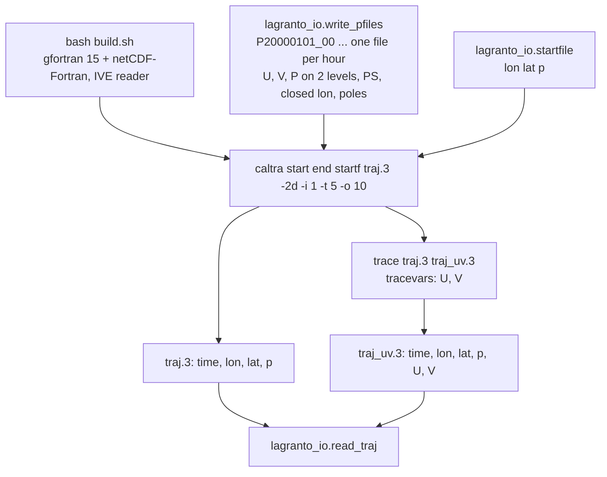

# LAGRANTO for 2-D (model-level) trajectories

LAGRANTO is the Lagrangian analysis tool of Michael Sprenger and Heini Wernli (ETH Zurich): `caltra` integrates
parcel trajectories through gridded winds, `trace` interpolates fields along them, `select` filters them.
Reference: M. Sprenger and H. Wernli (2015), The LAGRANTO Lagrangian analysis tool – version 2.0, Geosci. Model Dev. 8, 2569–2586, doi:10.5194/gmd-8-2569-2015.

Here it computes 2-D trajectories from the winds of our barotropic vorticity model (BVE); 3-D trajectories from
Isca come later.

## Source

- LAGRANTO.ecmwf trunk, revision 47, from the ETH public SVN https://svn.iac.ethz.ch/pub/lagranto.ecmwf/trunk/,
  licence GPLv3 (`LICENSE.pdf`). This directory is that trunk, flattened (`caltra/`, `trace/`, `lib/`, ...).
- Two small source edits, listed with reasons in `PATCHES.md`: binary trajectory output opened an
  uninitialised Fortran unit (`lib/iotra.f`), and the 500-input-file limit is raised to 5000 (`caltra/caltra.f`,
  `trace/trace.f90`). Everything else is unmodified.

## Build

```bash
bash build.sh          # clean rebuild, log in build.log (about 10 s)
export LAGRANTO=/path/to/ki-lagrangian-tracks/lagranto
export PATH=$LAGRANTO/bin:$PATH
```

- Compiler: gfortran 15.3 and netCDF-Fortran 4.6.4 from micromamba env `isca` (`nf-config --fflags/--flibs`;
  `nc-config --flibs` is empty in conda). Binaries carry an rpath to the env's `lib/`, so they run without
  activating the env.
- Flags: `-O -fallow-argument-mismatch`. gfortran 15 turns the legacy rank/type mismatches of the netCDF-2 calls
  into errors; this flag makes them warnings (they are harmless here). Nothing else is needed.
- Built: `lib/*.a` (iotra, ioinp, inter, times, libcdfio, libcdfplus), `caltra`, `trace`, `create_startf`,
  `select`, `density`, `lidar`, the goodies used by the scripts (`gettidiff`, `newtime`, `getvars`, `trainfo`,
  `datelist`, `changet`, `getmima`, `reformat`, `mergetra`, `extract`, `difference`, `timeres`, `list2lsl`,
  `lsl2list`, `lsl2rdf`), and the `bin/` links of `install.csh links`. `build.sh` also sets the exec bits of the
  `.sh` scripts (the export carries none).
- Input reader: `LAGRANTO_INPUT=ive` (default) compiles `lib/ioinp_ive.f`, the IVE netCDF reader. It is the only
  reader that implements `caltra -2d` (the `P.ML` request); the trunk's `lib/ioinp.f` (CF/CDO files with
  hyam/hybm, `LAGRANTO_INPUT=cf`) has no 2-D path. `install.csh` also defaults to the IVE reader.

## P-file format for `caltra -2d`

Each row was checked by running caltra/trace, except the parts marked (source), which are read off `lib/ioinp_ive.f`,
`lib/libcdfio.f` and `caltra.f`.

One netCDF file per time, named `PYYYYMMDD_HH`, all in the directory where `caltra`/`trace` are started.
`python/lagranto_io.py:write_pfiles` writes exactly this.

| Item | Requirement |
|------|-------------|
| Variables | `U`, `V` (m/s) and `P` (hPa, pressure of each model level), dims (CDL order) `(time=1, nz, ny, nx)`; `PS` (hPa) dims `(time=1, 1, ny, nx)`. All `float` (`NC_FLOAT`; (source) `getdef` rejects other types). Dimension names are free. |
| Levels | 2 identical levels. caltra -2d also runs with 1 level, but `trace` stops with "the first tracing variable must be 3D". Level 1 (first in the file) is the bottom: the writer uses P = 600 and 400 hPa, PS = 1000 hPa. Start parcels at a pressure between the levels (500 hPa); the parcel keeps its level index, and the output `p` column is `P` at that index. A start pressure above PS marks the parcel "below topography". |
| Grid | Regular lon-lat. The grid comes from per-variable attributes `xmin`, `xmax`, `ymin`, `ymax` (no coordinate variables are read); `missing_data` (-999) must exist or caltra fails ("Cannot retrieve grid dimension"). `zmin`, `zmax`, `xstag`, `ystag`, `zstag` are read but not checked (removing `zstag` changed nothing); the writer sets them. Latitude south to north ((source) caltra's domain test assumes `ymin < ymax`). |
| Longitude | A global grid must be closed: the first column repeated at `xmin + 360` (nx = 361 for 1 deg). caltra then sets periodicity 360 by itself. An open global grid aborts with "close arrays on files". Tested with `xmin = 0`; output longitudes lie in `[xmin, xmin + 360)`. |
| Poles | Include the rows lat = -90 and 90. Parcels beyond the first or last row are flagged as leaving the domain (with rows at +-89.5, 22 of 40 parcels routed within 3 deg of a pole were lost). |
| Time | A `time(time)` variable must exist ((source) `getdat` looks it up); its value is not used unless `-timecheck` is given (a value of 999 changed nothing). The writer stores hours since the first file. |
| Constants | `trace` needs the IVE constants block: global attribute `constants_file_name` naming a netCDF file with dim `nz` and variables `aklev`, `bklev`, `aklay`, `bklay` (nz) and scalars `pollon`, `pollat`. The writer puts this block into each P file and points the attribute at the file itself, so symlinked P files work (verified). caltra -2d runs without it; trace fails with "Problem with level coefficients". |

Start file (`lagranto_io.startfile`): plain text, one `lon lat p` line per parcel; (source) the file name must not
contain a dot followed by a digit (`caltra.sh` reads `.1`...`.9` as a trajectory-format suffix).

## Commands

```bash
cd <directory with the P files>            # or a run directory of symlinks to them
caltra 20000101_00 20000103_00 startf traj.3 -2d -i 1 -t 5 -o 10
printf "U 1. 0 P\nV 1. 0 P\n" > tracevars
trace traj.3 traj_uv.3
```

- `-2d` model-level trajectories (needs `P` and `PS` on the P files); `-i 1` hourly input; `-t 5` step in
  minutes; `-o 10` output interval in minutes (a multiple of `-t`). Do not pass `-p` (see Gotchas).
- Output format from the suffix: `.3` binary, full single precision (preferred); `.1` or no suffix ASCII,
  lon/lat rounded to 0.01 deg (about 1 km), `p` to 1 hPa, traced fields to 0.001.
- Python side:

```python
from lagranto_io import write_pfiles, startfile, read_traj
write_pfiles(rundir, times, lon, lat, u, v)        # u, v: (nt, ny, nx) m/s; times: datetime64, full hours
startfile(rundir / "startf", lon0, lat0, 500.0)
tr = read_traj(rundir / "traj_uv.3")              # tr["time"] (h), tr["lon"], tr["lat"], tr["U"], ...: (ntime, ntraj)
```

## Accuracy (synthetic solid-body winds)

Setup: 1 deg global grid with poles (181 x 361 after closing), hourly P files over 48 h from 2000-01-01 00 UTC,
200 parcels (10 latitudes 20-75N x 20 longitudes), output every 10 min. (a) zonal flow u = 30 cos(lat) m/s;
(b) solid-body rotation about the axis through 45N, 0E, peak speed 30 m/s. Analytic positions are rotations of the
start points; caltra's metric (1.112e5 m per degree) is used for the sphere radius. Great-circle error in km:

| Case | Step | 24 h median | 24 h max | 48 h median | 48 h max |
|------|------|-------------|----------|-------------|----------|
| zonal  | 10 min | 0.054 | 0.079 | 0.107 | 0.159 |
| zonal  | 5 min  | 0.054 | 0.079 | 0.107 | 0.159 |
| zonal  | 2 min  | 0.185 | 0.380 | 0.324 | 0.760 |
| zonal  | 1 min  | 0.289 | 1.92  | 0.577 | 3.83  |
| tilted | 10 min | 0.725 | 6.12  | 1.22  | 9.99  |
| tilted | 5 min  | 0.358 | 3.05  | 0.614 | 4.99  |
| tilted | 2 min  | 0.135 | 1.23  | 0.242 | 1.99  |
| tilted | 1 min  | 0.074 | 0.63  | 0.137 | 0.99  |

- Zonal: latitude stays fixed to 3e-6 deg; at 5 min the 10-min longitude increment is within 1e-5 deg of the
  exact 0.16187 deg. The error at 5-10 min is the bilinear interpolation of the wind. Shorter steps make it worse: the
  positions are single precision, and on a steady flow every step adds the same rounding error.
- Tilted: the error is first order in the step (max 9.99 / 4.99 / 1.99 / 0.99 km at 10 / 5 / 2 / 1 min). This is
  the integrator, not the file format: a numpy copy of caltra's iterative Euler step with the exact analytic wind
  (no grid, double precision) gives 9.99 / 4.99 / 1.99 / 1.00 km. The cause is that the zonal displacement is
  divided by cos(latitude at the start of the step); with the mid-step latitude the same copy gives a 48-h
  maximum of 0.06 km at 5 min.
- `trace`: U and V along the 5-min trajectories match the analytic wind at the traced positions to 0.0018 m/s
  (rms 0.0007), the bilinear interpolation error of a 1 deg grid.
- Pole crossings (40 parcels routed 0-3 deg from a pole, same tilted flow, max error over 48 h): north pole
  59 km at 10 min, 1059 km at 5 min (the parcel that passes over the pole), 2.6 km at 2 min, 1.2 km at 1 min;
  south pole 46 km at 5 min, 6.7 km at 1 min.
- `tests/test_lagranto_2d.py` repeats the 5-min and 1-min runs and trace and asserts these numbers with a margin
  of about 1.5 (`micromamba run -n isca python -m pytest -q tests/test_lagranto_2d.py`, 45 s).

## Scale test: 30 days, 2000 parcels, T85-size grid

256 x 129 equiangular grid with poles (1.40625 deg), 721 hourly P files (1.2 MB each, written in 81 s), same
tilted flow, 2000 random parcels 20-75N, 10-min output:

| Step | Wall time | 30-day median error | 30-day max error |
|------|-----------|---------------------|------------------|
| 5 min | 72 s (of which about 40 s is caltra.sh calling newtime/getvars once per file) | 5.2 km | 60 km |
| 2 min | 114 s | 4.7 km | 6046 km (1 parcel) |
| 1 min | 188 s | 4.2 km | 5.2 km |

Memory 160 MB; the `.3` output is 138 MB (an ASCII `.1` file is about twice that). `trace` of U and V: 21 s,
560 MB, 207 MB output. The large errors come from 1-3 of the 2000 parcels, each after passing within 0.1 deg of
the north pole.

## Gotchas

- Run caltra and trace inside the directory with the P files (or symlinks to them). `caltra.param`,
  `trace.param` and `trainfo.param` are written there, so two runs must not share a directory.
- caltra stores the start-file and output paths in 80 characters; a 108-character absolute path failed with
  "End of file". Use short relative names.
- Exit status 0 does not mean success: caltra and trace end with Fortran `stop` on input errors (missing
  attribute, missing constants block, single level for trace) and the scripts report status 0. Check that the
  output file exists (the pytest does).
- `-p` writes a periodicity of 1 (degree) into `caltra.param`; on a global grid every longitude is then wrapped
  modulo 1 deg. The closed grid alone makes the domain periodic.
- Parcels that come within about 0.1 deg of the north pole can be misplaced by tens to thousands of km
  (caltra clamps the latitude at 89.99 and divides the zonal step by cos(latitude)). The south pole has no clamp
  (parcels reach -90.000) and shows smaller jumps. Use 1-2 min steps for global runs and screen parcels whose
  latitude exceeds 89.9 deg or whose 10-min displacement is far above the local wind speed times 10 min.
- With hourly files the wind is interpolated linearly in time and bilinearly in space; positions are single
  precision. Below about 2 min the rounding error grows with the number of steps.
- T85 spectral output on the Gaussian grid cannot be used directly: LAGRANTO needs equally spaced latitudes and
  the pole rows. Evaluate the spectral winds on an equiangular grid with poles (in torch-harmonics 0.6.5,
  `grid="equiangular"` with nlat = 129 for 256 longitudes gives 90 to -90 deg in 1.40625 deg steps).
- caltra's sphere radius is 1.112e5 m per degree (6371.3 km); for a model with a = 6371.0 km the speed mismatch
  is 0.004 %.

## Flow


